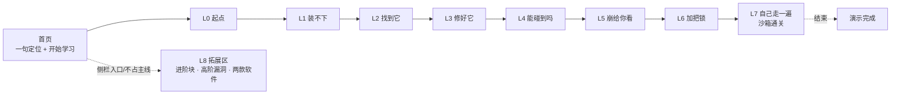

# BinInsight 课程作业增量改造 · 增量 PRD

> 文档编号：01 ｜ 撰写：许清楚（Xu）· 产品经理 ｜ 版本：v1.0
> **性质**：增量 PRD（简单 PRD 格式）。只界定「产品侧要改成什么样」，**不做架构设计、不做技术选型、不下技术实现可行性结论**——那部分由架构师后续给出。
> **依据**：① 已交付核查报告 `dilipa-algorithm-review.md`（结论直接采信）；② 对工作副本 `D:\WorkSpace\BinInsight-Coursework` 的实读：19 个 `page.tsx`、`src/components/` 关键组件、`src/data/` 数据文件。
> **范围**：只在工作副本落盘文档；不推送远程、不改 GitHub、不写产品代码。

---

## 0. 项目信息

| 项 | 内容 |
|---|---|
| Language | 中文（与用户要求一致） |
| Programming Language | **沿用现有 Next.js 16 + React 19 + Tailwind CSS**（增量改造，不换栈；用户已指定工作副本） |
| Project Name | `bininsight_coursework_incremental` |
| 工作副本 | `D:\WorkSpace\BinInsight-Coursework`（src/ 约 1.2 万行 TSX，19 条 page 路由） |
| 对照基线 | `D:\WorkSpace\BinInsight`（pristine，仅作对照，不改） |
| 现有栏目 | 首页 `/`、`/learn`(step1~step4)、`/reference`(stack/uaf/fmtstr/heap/glossary)、`/cases`(含在线沙箱)、`/tools`(dilipa/mutagen)、`/terms` |

**原始需求复述**：①「取其精华去其糟粕，审视整个项目（网页和软件），有能直接拿来用的算法就用」；②「网站能美观大方，适合新手，难度一点点提升而不是突然出现崭新的东西，希望没学过代码的人也能看懂」；③「软件能与网站联动最好」；④「你看我两个软件各自的设计理念是可实现的吗？现目前只完成 Dilipa 这个软件」。

**成功标准的硬约束**：这是本科课程作业，只给老师和自己看，不发表论文、不追求学术创新。核心成功标准不是「功能多/技术深」，而是：**演示时老师能看懂、学生能顺着走完、不出现「讲到一半冒出一个从没解释过的新概念」**。

---

## 1. 产品目标

**一句话定位**：把 BinInsight 从「看起来很全的二进制安全门户」，改造成「老师能顺着讲完、零基础同学能自己走完的一堂 15 分钟课」。

**3 条可验收的成功标准**：

| # | 成功标准 | 验收方式 |
|---|---|---|
| S1 | **老师演示无「新概念突袭」** | 从首页点「开始学习」走到沙箱通关，全程每级 ≤1 个新概念，且每个新概念在前一级都未被当作已知使用；随机抽 5 个页面术语，均能在站内 1 次点击内找到白话解释；老师无需临时补充任何页面未解释的名词 |
| S2 | **零基础同学可独立通关** | 找 1 位没学过代码的同学，无外部资料、无口头讲解，15 分钟内走完主线；8 道「理解标志」自检题至少答对 6 道；中途不出现「看不懂所以跳页」 |
| S3 | **全站零「虚假成品」** | 老师按页面任意一句功能描述去验证（跑一次 Dilipa、找 Mutagen 可执行文件、点下载按钮），得到的结论与页面描述一致；全站不出现未标注来源的「已验证 / 已完成 / 检测成功 / PASS」日志与统计数字 |

---

## 2. 目标用户与用户故事

### 2.1 零基础同学（小李，非计算机专业，第一次接触「二进制」）

- As a 零基础同学，I want 每进入新的一级只遇到 **1 个**新词、且这个词点一下就有白话解释，so that 我不用一边看一边百度，也不会因为突然冒出没讲过的词而直接放弃。
- As a 零基础同学，I want 点错/选错时立刻告诉我「为什么错」并允许重来，so that 我敢自己动手试，而不是只敢等老师演示完再照着点。

### 2.2 授课老师（王老师，看演示、会追问）

- As a 授课老师，I want 一条从首页到沙箱的固定演示动线，沿途所有概念都在前一级出现过，so that 我讲的时候不会被迫中途解释一个从没提过的名词。
- As a 授课老师，I want 页面上每个「已实现 / 演示样例 / 规划中」都有明确标注，so that 我问「这个跑一下看看」时学生能给出确定答案，不会卡在「以为做了其实没做」。

### 2.3 作者本人（做演示、答问）

- As a 作者本人，I want 演示前 1 分钟内能复现所有要展示的结果（含 Dilipa 的真实输出，或明确标注的预置样例），so that 现场不会因为「跑不出来」而慌乱。
- As a 作者本人，I want 两个软件的介绍能清楚说出「做了什么、没做什么、为什么没做」，so that 老师追问工作量与范围时我能正面回答，而不是被问到穿帮。

---

## 3. 「精华 / 糟粕」清单（产品视角）

处置分三类：**✅ 保留放大**（现成的好东西，直接拿来用）／**✏️ 删改**（会伤害可信度，必须改文案或删）／**📋 降级为规划**（内容可留，但不能以「已完成」出现在主线）。

| # | 现有内容 | 位置（实读） | 产品判断 | 处置 |
|---|---|---|---|---|
| 1 | step2「全行可点反汇编」+ 三步定位法 + 点错也有解释 + 自动标注 | `learn/step2/page.tsx` 239–427 | **全站最适合零基础的交互范式**：把「找漏洞」变成可点的动作，且容错 | ✅ 保留放大，收敛为 L2 主线核心交互 |
| 2 | step1「新手路线」三点引导（.text → .rodata → .got / 依次点一遍） | `learn/step1/page.tsx` 215–238 | 已有「一次只引导一个动作」的雏形，正好符合难度渐进 | ✅ 保留放大，扩展为全站 8 级路径 |
| 3 | step3 预设场景 A/B/C（"hi" / "CMD!" / "CMDaaaa…"）+ 逐条解读 | `learn/step3/page.tsx` 61–87 | 用**具体输入**代替抽象概念，是零基础最有效的讲法 | ✅ 保留放大，L4 直接用 |
| 4 | step4 补丁 diff 左右并排高亮（vuln vs patched） | `learn/step4/page.tsx` 331–424 | 直观、不撒谎，「改了什么」一眼可见 | ✅ 保留放大，L3 用 |
| 5 | 四段式工作台（原理→演示→动手→防御视角）+ 防护开关矩阵 DefenseSwitcher | `/reference/*`、`DefenseSwitcher.tsx` | 结构很好，但内容难度过高 | ✅ 保留骨架，主线只取「原理 + 演示」，降级见 #20 |
| 6 | 随文括号注释（`GDB（GNU 调试器）`、`rip（指令指针寄存器）`）+ `/reference/glossary` 23 词条 | 全站多处、`reference/glossary/page.tsx` | 术语解释的**种子**已存在，只是被动、静态、覆盖不全 | ✅ 保留并升级为可点击术语入口（见 P0-4） |
| 7 | `/cases` 在线沙箱：浏览器内完成、指导模式默认开、点错有解释、分新手/进阶、通关看防护建议 | `cases/page.tsx`、`SandboxPlayer.tsx`、`data/sandbox.ts` | 完整闭环，天然是主线的「终点考场」 | ✅ 保留放大，作为 L7 |
| 8 | 渐进解锁 + localStorage 进度、LearnPath 纵向路径、ModeToggle 新手/进阶 | `PathPreview.tsx`、`LearnPath.tsx`、`useProgress.ts`、`ModeToggle.tsx` | 视觉与状态机制可直接复用 | ✅ 保留（ModeToggle 处置见待确认 Q2） |
| 9 | CWE 编号贯穿案例与沙箱（CWE-120/416/134/121） | `data/cases.ts`、`data/sandbox.ts` | 好的「知识锚点」，但零基础不该背编号 | ✅ 保留，仅放拓展区与案例卡（见待确认 Q7） |
| 10 | 编辑式排版、留白、字号层级、发丝分隔、亮/暗主题 | `globals.css`、各页 | 美观基础已经很好，不必推倒重来 | ✅ 保留，按第 6 节做减法 |
| 11 | `/tools/dilipa` 页面的诚实文案：pipeline 第 05 步「当前为预览模式」、FAQ「patch 不直接写二进制」、工作台底部「使用预置样例数据」 | `tools/dilipa/page.tsx` 33–35 / 48–50 / 175–177 | **应作为全站文案基准** | ✅ 保留并推广到其它页面 |
| 12 | 使用条款 / 教育用途 / 合法授权免责声明 | `/terms`、`data/terms.ts` | 课程作业该有 | ✅ 保留（但内容需修正，见 P1-5） |
| 13 | DilipaWorkbench Step 6 标题「生成补丁 · Trampoline 注入」+「补丁会经过三重校验后输出」 | `DilipaWorkbench.tsx` 799–806 | 与 #11 同页自相矛盾，是**最伤可信度**的一处 | ✏️ 删改：改「补丁方案预览 · 变更清单」 |
| 14 | 三重校验 = 三个写死 `'OK'`（校验和对比 / 反汇编验证 / 功能测试） | `DilipaWorkbench.tsx` 836–838 | 无计算、无重反汇编、无测试；老师一问就穿帮 | ✏️ 删除，或改「未执行 · 本阶段仅预览」 |
| 15 | 终端日志 `[4/4] Trampoline 注入完成`、`Done: target.elf.patched (verified OK)`、`code cave @ 0x401c00` | `DilipaWorkbench.tsx` 116–117 / 203–204 | 预置字符串伪装成真实运行输出 | ✏️ 删改：改「已生成 3 条变更建议（JSON），未写入二进制」 |
| 16 | 工作台 C 代码 / 汇编 / AST Diff / 指令映射全为 `funcs` 硬编码 | `DilipaWorkbench.tsx:41` 起 | 六步演示数据无一是真实分析结果 | ✏️ 必须显著标注「演示样例（非真实分析结果）」，或改为真实 JSON 导入 |
| 17 | Mutagen 页：TerminalMock `[FIX] Patch verified: PASS`、报告统计（2 高危/3 中危/3 已自动修复/42 函数）、Docker 命令与 `Mutagen v1.2.0`、GitHub Release / Docker Pull 按钮、`LLM_API_KEY` 配置、FAQ「预计 v2.0 支持 PE」 | `tools/mutagen/page.tsx` 71–153 / 155–184 / 213–231 / 367–399 | 零实现却全是**成品口吻**，且按钮指向不存在的仓库；核查报告原话「比没做更伤，因为你说做了」 | ✏️ 删除或改为「规划中」占位 |
| 18 | Mutagen「检测的漏洞类别」表：8 个 CWE 标「完整支持 / 部分支持」 | `tools/mutagen/page.tsx` 16–25 / 281–307 | 零实现谈支持度，老师必然追问「跑一下」 | ✏️ 删除 |
| 19 | 首页「两款互补工具…Mutagen 一键自动化检测与修复」「基于 Ghidra」「开源工具链，本地运行」；`/tools`「两款工具均依赖 Ghidra」+ 联动路径 A→B→C；`/cases`「真实工具链（Ghidra、GDB、Mutagen）」；`cases.ts` 标准答案「运行 Mutagen 扫描应检测到 CWE-120…自动修复建议应将 gets 替换为 fgets」 | `app/page.tsx` 26–32 / 60–62；`tools/page.tsx` 24–40 / 55–58 / 129–147；`cases/page.tsx` 185–188；`data/cases.ts` 118 / 232 / 329 | 把不存在的工具写进导航、前置条件、联动流程甚至**标准答案** | ✏️ 全部改为诚实表述（P0-3） |
| 20 | Mutagen 整体理念（AI fuzzer / 符号执行 / 覆盖率引导 / LLM / 多 Agent 协作 / Ghidra headless / 5 语言 / 无源码） | `tools/mutagen/page.tsx` 全文 | 6~8 个独立子系统，本课程作业讲不通也演示不出 | 📋 降级为规划：改「设计构想 / 后续工作」单页 |
| 21 | 工具联动 A→B→C（Mutagen 扫描 → 导出 diff → Dilipa 理解） | `tools/page.tsx` 98–127 | 两端都不成立 | 📋 降级为规划：标注「设想的联动，尚未打通」 |
| 22 | Dilipa 真实二进制重写 / 等长 call 改写 / Trampoline / code cave / 三重校验 / AST Diff 真实化 / Ghidra 提升 | 核查报告第二、三、五节 | 代码里不存在 | 📋 降级为规划：网页不再作为已完成功能展示 |
| 23 | step1 进阶（binwalk/固件/SBOM/FBOM）、step3 进阶（符号执行/欠约束 SE/Z3/路径爆炸）、step4 进阶（CFI/二进制重写/BinDiff/0day） | `learn/step1` 366–428；`learn/step3` 586–718；`learn/step4` 583–799 | 与主线和课程目标无关，是「突然冒出崭新东西」的重灾区 | 📋 降级为规划：移出主线，归 L8 拓展区 |
| 24 | `/reference` 的 uaf / fmtstr / heap 三个高阶工作台 + glossary C 组高阶词条 | `/reference/*`、`reference/glossary` C 组 | 内容质量高，但远超零基础 | 📋 降级为规划：主线导航移除，归 L8 并标注「不考」 |
| 25 | `/terms` 第三方声明列 Docker、占位邮箱 `legal@bininsight.example.com` | `data/terms.ts` 49–67 | 与实际交付物不符，老师细看会追问 | ✏️ 修正（P1-5） |

**「有能直接拿来用的算法就用」的产品侧回答**：可拿来用的是上面 #1~#8 这批**教学交互范式**（逐行解释、预设场景、并排 diff、防护开关、渐进解锁），以及 Dilipa 真实存在的「ELF 解析 → 反汇编 → 危险函数名单 → JSON 报告」链路。核查报告里提到的 E9Patch / RetroWrite / GumTree / VeriBin 等属于后续技术工作，本 PRD 不纳入课程作业范围。

> 补充澄清：`src/components/TermsDrawer.tsx` 实为**使用条款抽屉**，不是术语解释抽屉；现有术语解释靠随文括号注释 + glossary 静态页。产品侧要求新建「术语解释」入口并与之明确区分（见 P0-4、待确认 Q10）。

---

## 4. 难度渐进的学习路线（重点）

### 4.1 编排原则（4 条硬规则）

1. **每级 ≤1 个新概念**：新概念必须「一句生活化白话定义 + 一个可点/可看的例子」在前，术语在后。
2. **不复用即不出现**：本级只能使用「本级新概念 + 前级已学概念」，任何其它术语必须挂术语解释入口、且不得作为理解前提。
3. **进阶内容不入主线**：现有「新手/进阶」双模式中的进阶块、reference 的高阶漏洞、glossary 高阶词条、tools 全部归入 **L8 拓展区**，显式标注「主线演示与考核不涉及」。
4. **末级不引入新概念**：L7 是纯复用与检验，保证「难度一点点提升」而不是在终点再抛一批新东西。

### 4.2 L0~L8 递进链（重排现有栏目，尽量复用现有页面/组件）

| 级 | 本级唯一新概念 | 复用前级已学 | 学生动作 | 可验收的理解标志 | 复用现有资产 |
|---|---|---|---|---|---|
| **L0** 起点 | 「程序 = 一堆步骤 + 一块放数据的地方」（菜谱 + 冰箱）；**不出现** ELF/二进制/汇编 | 无（第一级） | 点「开始学习」→ 看一张 C 代码 ↔「电脑实际做的事」对照图 → 点「我看懂了」 | 能说出「程序会读输入，并把输入放进一个固定大小的盒子」 | 首页 Hero 区改文案；新增 1 张对照图 |
| **L1** 装不下 | **缓冲区溢出**（水倒进小杯，多出来的洒到旁边） | L0 的输入→盒子 | 拖动滑块加长输入，看盒子溢出、旁边「返回地址」被染色；每处可点开白话解释 | 能指出「多出来的数据盖住了别的东西」，并答出「盖住的是程序下一步要跳去的地方」 | `learn/step2` 的 `vulnerableCSource`；`reference/stack` 的 `StackFrameSVG` 简化版 |
| **L2** 找到它 | **call = 去调用一个现成函数**（只教这 1 条指令，其余 7 条指令沉到术语抽屉） | L1 的 strcpy / 溢出 | 沿用「三步定位法」但收敛为 2 步：① 找 call ② 看名字里有没有 strcpy；点错仍有解释 | 能在 32 行汇编里点中 strcpy 那行，并说出「它不检查长度」 | `learn/step2` 2.2 全行可点练习（原样复用，仅删未教术语） |
| **L3** 修好它 | **限长函数 strncpy**（给杯子加一条刻度线） | L1/L2 的 strcpy、溢出、call | 左右并排 diff 点高亮行看「改了什么」；做一次 2 选 1「哪种写法安全」 | 能说出「strcpy → strncpy 加了长度上限」；「还要手动补 \0」以提示卡给出（算注意事项，不算新概念） | `learn/step4` 2 补丁 diff；`learn/step2` 的 `safe_func`；`reference/stack` 的 fixOptions（砍到 2 项） |
| **L4** 能碰到吗 | **条件门槛**（进园要同时过身高 + 门票两道关） | L1~L3 的 strcpy 漏洞点 | 依次点预设 A "hi" / B "CMD!" / C "CMDaaaa…"，读解读；勾选项标签由 `len(input)>10` 改为「输入够长吗」「开头是 CMD 吗」 | 能说出「两道关都过了才会走到 strcpy」，并解释 A 为什么走不到 | `learn/step3` `PathExplorer` 场景 A/B/C（**砍掉 CFG/ENTRY/BRANCH/SINK 图例与图论词汇**） |
| **L5** 崩给你看 | **崩溃 = 程序被强行停下、留下现场**（车祸后看刹车痕）。GDB 只作为「看现场的工具」出现 1 次 | L1 溢出、L4「走到漏洞点」 | 点 step → 播放**明确标注「预录演示」**的终端，只认一个现象：rip 变成 0x41414141（'A'） | 能说出「'A' 写到了本该是地址的地方」；**不需要会敲 GDB 命令** | `learn/step3` 3.5；`reference/stack` 02 `DemoTerminal`（保留其「预录制」诚实标注） |
| **L6** 加把锁 | **防护 = 编译器/系统自动加的检查**，一次只讲 1 把锁：Canary「门口贴的封条，撕破就报警」；NX/ASLR 一句话带过不展开 | L1 溢出、L5 崩溃 | 切「无防护 / 开 Canary」，看同一输入一次成功一次被拦；「绕过方法」整块移拓展区 | 能说出「Canary 是返回地址前的一个随机数，被改了就终止」 | `learn/step4` 4.1（**只留 None/Canary/NX 三个标签**）；`DefenseSwitcher`（砍到 1 个开关） |
| **L7** 自己走一遍 | **0 个新概念**（纯复用与检验，关键） | L0~L6 全部 | 进新手沙箱（指导模式默认开），走完 5 阶段；选项只用前面出现过的词 | 不看提示独立完成；能对着标准答案说出「哪步用了 L2 的 call、哪步用了 L6 的 Canary」 | `/cases` 新手区沙箱 + `PathPreview` 解锁 + `reference/stack` 04 防御视角作收尾 |
| **L8** 拓展区 | 不设新概念（**不计入主线、不演示、不考核**） | — | 学有余力自行浏览 | 无考核 | Dilipa 诚实介绍、Mutagen 设计构想、`reference` 的 uaf/fmtstr/heap、glossary 全部词条、step1~step4 全部进阶块；入口显式标注「主线演示不会用到，老师提问也不会考」 |

**主线动线**：首页「开始学习」→ L0 → … → L7（沙箱通关）→ 结束。**L8 只从侧栏「拓展阅读（不考）」进入**，不出现在前进按钮上。

### 4.3 当前网站在哪些位置「突然出现崭新东西」（实读证据）

| # | 页面 / 位置 | 具体突然出现的术语 | 为什么突兀 |
|---|---|---|---|
| 1 | 首页首屏关键词条 `app/page.tsx:6–14` | `GHIDRA` `CONTROL-FLOW GRAPH` `TAINT ANALYSIS` `STACK CANARY` `CFI` `PATCH DIFF` | landing 第一屏就是 7 个未解释英文术语，零基础同学第一个动作就是「看不懂」 |
| 2 | `learn/step1` 1.1 各 section 的「与漏洞的关系」`:28 / :56 / :63 / :70` | 「控制流劫持（如栈溢出）跳转到其中的 **gadget（ROP 攻击）**」「**GOT 表 / RELRO**」「利用 PLT 中的 system 构造 **ROP 链**」「符号表剥离可增加**逆向难度**」 | 第 1 课、还没定义「溢出」，就要求理解 5+ 个后续概念 |
| 3 | `learn/step1` 1.3（进阶）`:366–428` | `binwalk` `uImage` `LZMA` `Squashfs` `SBOM / FBOM` | 与「ELF 栈溢出」主线完全无关的一整套固件领域 |
| 4 | `learn/step1` 1.4 加壳与脱壳 `:430–485`（**新手模式也常显**，不在 advanced 条件内） | `UPX / ASPack / VMProtect / Themida` `OEP` `dump` `IAT 修复` `RWX`，且写「第一步**不是反汇编**」 | 打断刚建立的「分析 = 反汇编」认知，又开一个新领域 |
| 5 | `learn/step2` 2.1 `:195–236` + 2.2 逐行解释 `:90–129` | 一上来 32 行汇编 + `rbp/rsp/lea/rdi/rsi/rdx`、x86-64 调用约定、序言/尾声、`strip`、`Ghidra/IDA/Hex-Rays`；解释里直接谈「**返回地址被覆盖**」「**格式化字符串漏洞**（在案例区有专门练习）」 | 溢出与返回地址此时从未教过；还跨栏目甩一个未学漏洞 |
| 6 | `learn/step2` 2.5 栈帧图 `:609–626` | 图里直接出现 `canary（若开启栈保护）`、`返回地址 = 溢出攻击的终极目标` | Canary 到 step4 才讲，却在 step2 当已知使用 |
| 7 | `learn/step3` 3.1 `:273–295 / :438–452` | `控制流图 CFG` `ENTRY / BRANCH / SINK / EXIT` 图例、`约束条件 CONSTRAINTS`、`strncmp`、可达性 | 全新一套图论/程序分析语言，无任何过渡段 |
| 8 | `learn/step3` 进阶 3.2 `:586–718` | 符号执行、符号值、路径约束、`SMT 求解器 Z3`、`SATISFIABLE`、路径爆炸、`DFS/BFS`、路径合并、增量求解、下近似、**欠约束符号执行 / UNDER-CONSTRAINED SE** | 单页 10+ 新概念，全部无前置 |
| 9 | `learn/step3` 3.5 `:720–771` | `gdb` `bt` `info registers` `x/8gx $rsp` `rip` `rsp` `SIGSEGV` `0x41414141` | 新工具 + 新寄存器 + 新输出格式同时出现，且未解释「崩溃」是什么 |
| 10 | `learn/step4` 4.1 六标签 + 每标签「绕过方法」`:25–203` | `TLS` `__stack_chk_fail` `Return-to-libc / ROP / gadget` `PIE` `mprotect` `__malloc_hook / __free_hook` `House of 系列堆风水` `CPI/IBT/PAC` `影子栈` `数据导向攻击` `侧信道` | 一页几十个新名词，且「绕过方法」比「原理」更难，难度倒挂 |
| 11 | `learn/step4` 4.7 对抗表 `:816–851` | 「需要格式化字符串或 **UAF 读**」「需要**任意写**」「需要**可控 RIP**」「**ret2libc / ROP**」「泄露 + 任意写 + 控制流劫持的**组合拳**」 | 这些词在 step1~4 全站从未定义；紧接着底部按钮就「前往工具区」 |
| 12 | `/reference` 首页引言 `reference/page.tsx:44–46` | 「**虚表劫持**」「**tcache poisoning（tcache 投毒）**」「**任意写**」 | 这是通往**第一个**漏洞（栈溢出）的入口页，却先抛第 4 个漏洞的术语 |
| 13 | `reference/stack` 03 动手 `:226–234` | 「`pop rdi; ret` **gadget**」「`"/bin/sh"`」「`system()` 地址」「复制 **pwntools** 模板去打」 | 学生刚学完栈帧，就被要求填一条完整 ROP 链，ROP 本身从未教 |
| 14 | `reference/uaf` / `fmtstr` / `heap` | `vtable / 类型混淆 / one_gadget / ret2libc / RAII / Rust 所有权`；`%p 泄露 libc / %n 写 GOT / free@plt→system / FORTIFY_SOURCE / __printf_chk`；`tcache poisoning / unsorted bin / main_arena / safe-linking / glibc 2.26~2.34 / fd-bk / free_hook` | 每页各自引入一整套独立利用体系，且 glossary 自述「逻辑递进」但学生是被动跳进来的 |
| 15 | `/cases` `:139 / :185–188` + `data/cases.ts` 标准答案 | 进阶区「格式化字符串 → **UAF 虚表劫持** → **NX 下的 ROP 对抗**」；「真实工具链（Ghidra、GDB、**Mutagen**）」；「**运行 Mutagen 扫描应检测到 CWE-120…自动修复建议应将 gets 替换为 fgets**」 | 把未实现的工具写进学习建议和「标准答案」，学生照做必然扑空 |
| 16 | `/tools`、`/tools/mutagen`、首页三层体系第 Ⅱ 层 | `AI Fuzzer / 符号执行 / 覆盖率引导 / LLM / 多 Agent / Ghidra 无头 / 5 语言 / 无源码`，全部以成品口吻；`/tools` 还给出联动 A→B→C 与「均依赖 Ghidra」前置 | 从「学一个 strcpy」跳到「一套自动化漏洞挖掘平台」，是全站最大的一次难度与可信度断层 |

---

## 5. 需求池

优先级：**P0 = 必须有（不做则成功标准不达标）**／**P1 = 应该有**／**P2 = 锦上添花**。每条均含验收标准。

### P0（必须，且覆盖三项硬要求）

| ID | 需求 | 覆盖 | 验收标准 |
|---|---|---|---|
| **P0-1** | **零基础可读性**：按 4.2 的 L0~L7 重排主线，每级 ≤1 个新概念，新概念先白话定义后术语；正文首次出现的术语必须挂解释入口 | 零基础可读性 | ① 1 位没学过代码的同学无外部资料独立走完 L0→L7，8 道理解标志题 ≥6 对；② 主线页面脚本中不存在「未在前级出现即被当作已知使用」的术语（逐页词表核对）；③ 全站任意术语 1 次点击内可见白话解释 |
| **P0-2** | **删除 / 改造虚假演示**：DilipaWorkbench 的 Step 6 标题、三重 `OK`、终端 `verified OK` / `Trampoline 注入完成` / `code cave` 地址、硬编码 C/汇编/AST/指令映射，逐一改文案或标注「演示样例（非真实分析结果）」；Mutagen 的 TerminalMock、报告统计数字、Docker 命令/版本号、下载按钮、CWE 支持表删除或改「规划中」 | 删除/改造虚假演示 | 全站搜索 `verified OK`、`PASS`、`注入完成`、`完整支持`、`已自动修复`、`mutagen v1.2.0`、`docker pull bininsight` 命中 **0 处**；任何展示的日志/终端/报告都带「真实输出 / 演示样例 / 规划中」三选一状态标签 |
| **P0-3** | **两个软件介绍的诚实表述**：Dilipa 统一为「已实现：ELF 解析 + 反汇编 + 危险调用名单 + JSON 报告；未实现：二进制重写、三重校验、AST Diff 真实化、Ghidra 提升」；Mutagen 统一为「设计构想 / 后续工作，本次课程作业未实现」；同步改首页、`/tools` 联动说明、`/cases` 学习建议、`data/cases.ts` 标准答案 | 两个软件诚实表述 | 老师按任意页面文字去验证（跑 `dilipa patch`、找 Mutagen 二进制、点下载按钮），结论与页面描述一致；不产生「你说做了但跑不出来」；`/tools/dilipa` 的诚实文案成为全站基准 |
| **P0-4** | **全局术语解释入口**：把随文括号注释升级为可点击的术语浮层/抽屉，与 `reference/glossary` 共用一份数据；显示「白话解释 + 它属于第几级 + 去速查表」。**与现有 `TermsDrawer.tsx`（使用条款）明确区分** | 零基础可读性 | L0~L7 全部页面术语点击后 1 次操作内出解释；点击「术语」不会弹出法律条款；新增术语只需改一处数据 |
| **P0-5** | **路线重排与拓展区隔离**：按 L0~L8 重排 `LearnPath` / `PathPreview` / 首页「开始学习」；把进阶模式、reference 的 uaf/fmtstr/heap、glossary 高阶词条、tools 归入 L8 并显式标注「主线演示与考核不涉及」 | 零基础可读性 | 演示时从首页「开始学习」到沙箱通关，路径上不出现任何拓展区术语；前进按钮不通向 L8 |
| **P0-6** | **演示可复现性**：Dilipa 若参与演示，必须能用仓库内真实 ELF 样本跑出真实 JSON 并导入工作台（或明确只展示静态样例并标注），不得现场即兴 | 删除/改造虚假演示 + 作者演示 | 演示前 1 分钟内可复现；老师追问「这是真跑的吗」有明确、与页面一致的答案 |

### P1（应该有）

| ID | 需求 | 验收标准 |
|---|---|---|
| P1-1 | 首页与学习路径页按第 6 节视觉改造 | 首屏不再堆砌英文术语；主标题为白话；8 级进度线可见；字号层级 ≥3 级、正文 ≥15px、行高 ≥1.8；留白区块 ≥ 屏高 30% |
| P1-2 | 每级末尾「我看懂了吗」2 选 1 自检卡 | 复用 `/cases`「点错也有解释、不扣分」机制；答错给白话解释并可重来；8 级全覆盖 |
| P1-3 | **网站 ↔ Dilipa 轻量联动**（对应用户诉求③；产品侧只描述体验，技术选型交架构师） | 老师在网页点「用真实样本跑一次」，能看到与 Dilipa CLI 输出一致的 JSON 被渲染成 L2/L3 对照视图，页面标注「数据来源：dilipa analyze」；做不到时至少闭环「下载样例 JSON → 网页导入」 |
| P1-4 | 全站三态标签规范（真实输出 / 演示样例 / 规划中） | 所有演示、预览、规划内容统一标签与样式，视觉一致，不依赖读者猜测 |
| P1-5 | 修正 `/terms` 与第三方声明 | 条款不再出现未使用的 Docker、占位邮箱；与实际交付物一致 |

### P2（锦上添花）

| ID | 需求 | 验收标准 |
|---|---|---|
| P2-1 | 老师演示模式：一条 8 级动线 + 每级一句话讲稿 + 计时提示 +「老师可能追问的 3 问与标准回答」 | 演示可照稿走完，追问有准备答案 |
| P2-2 | 术语掌握度小测 / 进度回看（复用 localStorage） | 可回看已解锁级别与自检结果 |
| P2-3 | 亮/暗主题与字号偏好（复用 `ThemeToggle`） | 零基础同学可调大字号，布局不破 |
| P2-4 | 拓展区做成可折叠「学有余力」卡片 | 不占主线视觉，不干扰演示动线 |

---

## 6. UI 设计稿

**总原则**：美观大方靠**留白、字号层级、单一强调色**，不靠信息密度；一屏一个动作、一屏一个新词；颜色只用于表达**状态**（已解锁 / 演示样例 / 规划中），不用于装饰。现有编辑式排版、发丝分隔、亮暗主题保留，只做减法。

### 6.1 首页 `/`

```
┌──────────────────────────────────────────────────────────────┐
│ BinInsight   学习路径 · 案例 · 工具与拓展 · 术语 · 使用条款   │  ← 导航；「工具下载」改「工具与拓展」
├──────────────────────────────────────────────────────────────┤
│  本科课程作业 · 二进制安全入门            （eyebrow, 12px）   │
│                                                              │
│  从一行 C 代码，                      ① 一个装不下的盒子      │
│  看懂一次溢出                        ② 找到那个不检查长度的函数│  ← 右：8 级纵向路径线
│                     （主标题 48~64px）③ 给它加上限           │     每级仅中文短标题 +
│  不用装环境、不用懂汇编，                    … ⑧ 自己走一遍    │     「本级只学 1 件事」
│  15 分钟顺着走完这 8 步。                                    │     线宽/透明度区分状态
│  （副标题 16px / 行高 1.9）                                  │     不用彩色徽章
│                                                              │
│  [ 开始学习（约 15 分钟） ]   [ 老师演示动线 ]                │  ← 1 主 1 次，仅两个按钮
├──────────────────────────────────────────────────────────────┤
│ 本页所有演示内容均标注：真实输出 / 演示样例 / 规划中          │  ← 把「诚实」做成视觉元素
├──────────────────────────────────────────────────────────────┤
│ 你会学到什么  ① 一个装不下的盒子  ② 找到那个函数  ③ 加上限   │  ← 三卡，卡内是「理解标志」
├──────────────────────────────────────────────────────────────┤
│ 工具与拓展（不计入主线）                                      │
│ ┌ Dilipa ──────────────┐  ┌ Mutagen ──────────────────────┐ │
│ │ [已实现/未实现 状态标签]│  │ [规划中] 设计构想·本次未实现  │ │
│ │ 已实现：解析+反汇编+报告│  │ 一句话说明设计思路与边界      │ │
│ │ 未实现：二进制重写…    │  │                              │ │
│ └───────────────────────┘  └──────────────────────────────┘ │
└──────────────────────────────────────────────────────────────┘
```

- 首屏 3D `HeroCanvas` **降为低透明度背景纹理**，文字优先（见待确认 Q8）。
- 删掉现有 7 个英文关键词条、三层学习体系、分析四环节、「为什么选择我们」等信息密集模块；只保留「一句定位 + 一个动作 + 一条路径」。

### 6.2 学习路径页 `/learn`（L0~L7 通用骨架）

```
┌──────────────────────────────────────────────────────────────────┐
│ 首页 / 学习路径 / 第 2 级          第 2 级 / 共 8 级  ──●──○──○── │  ← 横向细进度线
├───────────────────────────────────────────┬──────────────────────┤
│ 左主栏（8 列，大留白）                    │ 右窄栏（4 列 sticky）│
│                                           │                      │
│ 本级只学 1 件事                          │ 8 级路径（当前高亮） │
│ ┌─────────────────────────────────────┐  │                      │
│ │ call 就是「去调用一个现成的函数」    │  │ 本级术语             │
│ │ （一句白话，无术语先行）            │  │ · call  ⓘ 点击解释   │
│ │ [ 30 秒可点交互：点一下这行 ]       │  │ · strcpy ⓘ          │
│ └─────────────────────────────────────┘  │ → 打开术语浮层：     │
│                                           │   白话解释 + 第几级  │
│ 用到的旧知识：〔输入→盒子〕〔溢出〕      │   + 去速查表          │
│  （可点回前级，显式复用）                │                      │
│                                           │ ▸ 拓展阅读（不考）   │
│ ┌──────── 交互区：一次只出现一个操作 ──┐  │   （折叠，默认收起） │
│ │        大留白，单列                 │  │                      │
│ └─────────────────────────────────────┘  │                      │
│                                           │                      │
│ 我看懂了吗？ 〔 A 〕〔 B 〕              │                      │
│  （答错给解释、不扣分、可重来）          │                      │
│                        [ 下一级 → ]      │                      │
└───────────────────────────────────────────┴──────────────────────┘
```

**字号层级**：级标题 32–40px ／ 小节 20–22px ／ 正文 **15–16px（行高 ≥1.85，最小 15px）** ／ 辅助 12–13px。
**术语视觉**：统一「虚线下划线 + ⓘ 图标」，表示可点开解释；正文首次出现必带。
**布局 Mermaid**：



---

## 7. 两个软件设计理念的产品侧判断

> 只回答「在课程作业里**讲不讲得通、演示不演示得出来、老师会不会追问**」；**技术实现可行性一律留给架构师**，本节不下技术结论。
> 附带回应原话④「两个软件各自的设计理念是可实现的吗」——从**产品叙事**看：Dilipa 的理念是「把补丁表达为 C 代码编辑」，收缩到「只读分析 + 变更预览」后自洽；Mutagen 的理念是「一键自动化发现并修复」，在本次作业范围与工作量下不自洽。是否真能实现，由架构师判断。

### 7.1 Dilipa —— **建议收缩范围 + 保留**（并作为「网站联动」的那一半）

| 角度 | 判断 |
|---|---|
| 讲得通吗 | **能，而且好讲**。「解析一个 ELF → 找出危险的 strcpy → 给出一份 JSON 变更建议」是一条 3 步画得完的因果链，和主线 L2/L3 完全咬合。老师不需要任何额外背景就能看懂「输入 → 报告」。 |
| 演示得出来吗 | **能，但必须收窄 + 预置**。真实可演示的是 `analyze` 的 ELF 解析、反汇编、危险函数名单、JSON 导出；`patch` 只输出 JSON 预览、不写二进制。且核查报告指出 `analyze` 因 `_parse_call_target()` 只认 `@plt` 而**永远检测不到 call**——现场即兴跑一次可能一条都扫不到。产品侧建议：用「已验证样本 + 已生成 JSON」的可复现闭环，不即兴。 |
| 老师会追问吗 | **会，且集中在三处**：①「Step 6 说生成补丁，补丁文件在哪？」②「三重校验 OK 是怎么算出来的？」③「网页这六步和 CLI 是同一份数据吗？」——现在三问都答不上来，因为工作台是硬编码，且页面文字（FAQ 说预览）与组件呈现（verified OK）自相矛盾。 |
| **结论** | **建议收缩范围 + 保留**：保留「ELF 解析 → 危险调用识别 → JSON 报告 → 网页可视化对照」这条真实链路，定位为「软件与网站联动的那一半」（正好满足诉求③）；把二进制重写 / Trampoline / code cave / 三重校验 / AST Diff 真实化 / Ghidra 提升全部标注「后续工作」，网页不再以「已完成」呈现。**这比补做功能更划算，也更诚实。** |

### 7.2 Mutagen —— **建议明确标注为规划**

| 角度 | 判断 |
|---|---|
| 讲得通吗 | **讲不通**。AI fuzzer + 符号执行 + 覆盖率引导 + LLM + 多 Agent 协作 + Ghidra headless + 5 种语言 + 无源码，是 6~8 个独立子系统，任何一项都够一个课程设计。全塞进一页，老师第一反应是「这个作业量不可能一个人做完」，反而会**连带质疑 Dilipa 的真实性**。 |
| 演示得出来吗 | **完全演示不出来**。只有一个概念页、代码里零实现；页面上的终端日志、版本号 `v1.2.0`、Docker 镜像、8 个 CWE 支持度、报告统计数字全是编的；「GitHub Release / Docker Pull」按钮指向不存在的仓库。 |
| 老师会追问吗 | **会，且是致命追问**：「跑一下看看？」「用的哪个模型？」「多 Agent 怎么分工？」——没有任何可回答的实物。核查报告原话：「比『没做』更伤——因为你说做了」。 |
| **结论** | **建议明确标注为规划**：保留一页「设计构想 / 后续工作」，讲清「本次课程作业未实现，仅说明设计思路与为什么这样划边界」；删除全部成品口吻（下载按钮、版本号、命令、CWE 支持度、终端输出、统计数字、FAQ 里的「当前版本 / 预计 v2.0」）。这样反而变成加分项：能正面回答「我为什么没做、边界在哪」。 |

**给架构师的交接提示（非结论）**：产品侧需要的是「Dilipa 真实链路能否稳定产出一个可展示的 JSON」以及「网页导入 JSON 的最小闭环」这两个事实判断，用来定 P0-6 / P1-3 的验收方式；请架构师给出判断，本 PRD 不预设技术方案。

---

## 8. 待确认问题（每条含推荐默认值）

| # | 需用户拍板的选项 | **推荐默认值** | 备选 / 影响 |
|---|---|---|---|
| Q1 | 主线分几级？ | **8 级（L0~L7 + L8 拓展区）**，不新增页面，只重排现有路由与导航 | 6 级（合并 L4/L5）；推荐 8 级是因为能最大限度复用现有交互组件 |
| Q2 | 现有「新手 / 进阶」双模式怎么处理？ | **主线固定「新手」；进阶内容整体移入 L8 并标注「不考」** | 保留开关但默认新手；推荐前者，避免老师演示时误切到进阶 |
| Q3 | Mutagen 保留成一页还是下线？ | **保留一页「设计构想 / 后续工作」（约 1 屏）**，不删入口 | 直接下线；推荐保留，因为它能回答「你考虑过自动化吗」 |
| Q4 | Dilipa 工作台六步留几步？ | **保留骨架、改名「补丁方案预览」、砍到 3 步**（选择函数 → 看 C 代码 → 看变更清单），其余标注「后续工作」 | 整体替换为「真实 JSON 导入 → 对照视图」；推荐前者（改动小、复用现有组件） |
| Q5 | 是否真做网站 ↔ 软件联动（诉求③）？ | **P1 做「下载/导入真实 JSON」轻量闭环即可，不做实时通信**；时间紧则降 P2，改用「演示前预置一份 JSON」 | 实时联动；推荐轻量闭环，风险最低 |
| Q6 | `reference` 的 uaf / fmtstr / heap 三个工作台怎么办？ | **保留代码不删，从主线导航移除，归 L8 并标注「不考」** | 删页面；推荐保留，避免丢失已有工作量 |
| Q7 | CWE 编号要不要保留？ | **保留**（CWE-120/416/134/121），但只作「案例编号/知识锚点」出现在拓展区与案例卡，**主线 L0~L7 不出现** | 全删；推荐保留，零基础不该背编号 |
| Q8 | 首页 3D 画布 `HeroCanvas` 留不留？ | **留，但降为低透明度背景纹理，文字优先** | 换静态渐变；推荐前者，保留现有美观基础 |
| Q9 | 演示时是否现场跑 Dilipa CLI？ | **不即兴跑**，用「已验证样本 + 已生成 JSON」可复现闭环；若老师坚持，另备一份说明当前 `analyze` 已知限制的 README | 现场跑；推荐不跑，规避核查报告指出的 call 检测缺陷 |
| Q10 | 「术语抽屉」与现有 `TermsDrawer`（使用条款）命名冲突？ | **新建「术语解释」浮层（复用 glossary 数据），现有抽屉明确改名/标注为「使用条款」** | 复用同一个抽屉加 Tab；推荐新建，避免老师点「术语」弹出法律条款 |
| Q11 | 要不要一份「老师演示讲稿」？ | **P2 做**：每级一句话 + 「老师可能追问的 3 问与标准回答」；**默认先不做**，等主线定稿 | 现在就做；推荐后置，避免主线改动后返工 |

---

## 附：本 PRD 的边界声明

- 本文**只描述产品侧改造范围与验收标准**，不含页面实现、组件拆分、数据结构、接口、依赖选型。
- 核查报告中的算法/文献（E9Patch、RetroWrite、GumTree、VeriBin、LIEF、栈帧启发式等）属于后续技术工作，本 PRD **未将其纳入课程作业必做范围**。
- 所有「已实现 / 未实现」表述均以核查报告结论为准；若架构师复核后有变化，请回传主理人，由产品经理同步修订 P0-3 与第 7 节文案。
