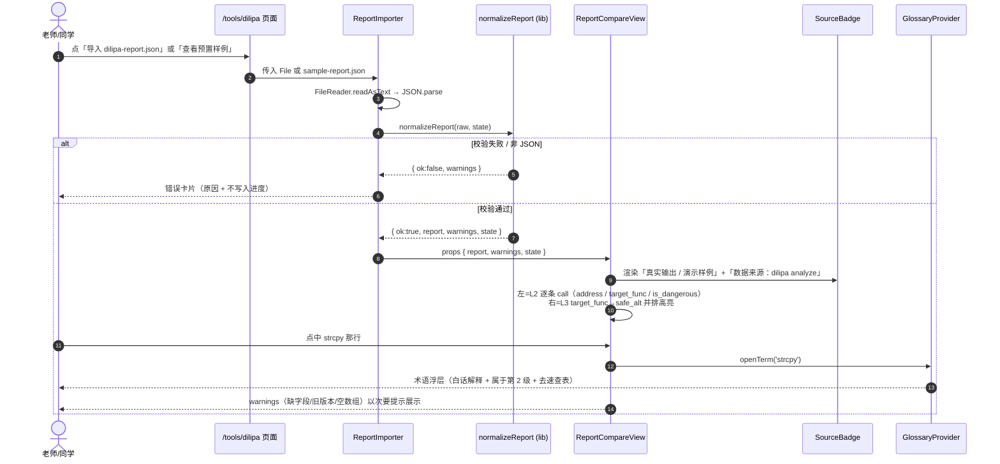
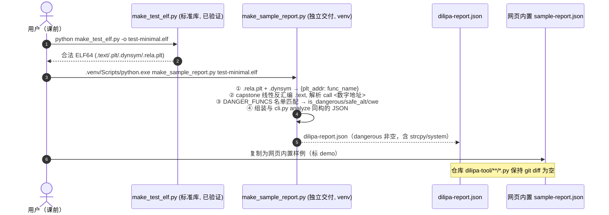
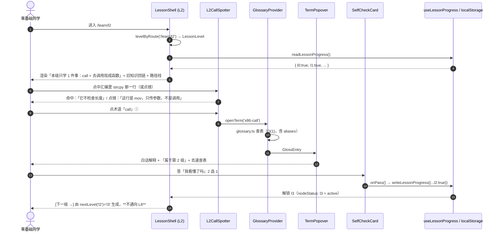
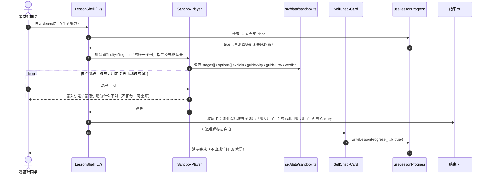
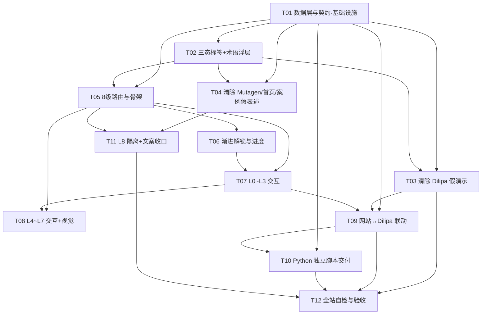

# BinInsight 课程作业增量改造 · 架构设计与任务分解

> 文档编号：02 ｜ 撰写：高见远（Gao）· 架构师 ｜ 版本：v1.0
> **输入**：`docs/01-增量PRD.md`（312 行，全文已读）、`deliverables/dilipa-algorithm-review.md`（核查结论直接采信）、对工作副本 `D:\WorkSpace\BinInsight-Coursework` 的逐文件实读（19 个 `page.tsx` / 19 个组件 / 4 个 data / `dilipa-tool/` 9 个 .py）。
> **性质**：只做架构设计与任务分解，**不含实现代码、不改 `src/`、不改 `dilipa-tool/**/*.py`、不推送远程**。
> **硬约束（写进每个任务的验收）**：① 网页侧 TSX/CSS/数据文件允许在 `BinInsight-Coursework` 工作副本内原地修改；② `dilipa-tool/` 的 Python 改动**一律不原地改**，只以「独立可运行的 .py 文件」交付到 `C:\Users\Lenovo\WorkBuddy\2026-11-13-10-08-35\deliverables\`，由用户自行运行验收后再谈提交；③ 全程禁止 `git push` / 任何远程改动。

---

## 0. 先回答用户最关心的那个问题（A 节摘要）

> **「我两个软件各自的设计理念是可实现的吗？」**
>
> - **Dilipa 的理念**（把补丁表达为提升后 C 代码的编辑，AST Diff 自动映射回指令）**是 PLDI/NDSS 级研究方向，不是一个本科课程作业能完整实现的**。但它**前半段是真做了的**：ELF 解析 → 反汇编 → 危险调用名单 → JSON 报告，这条链路能跑、能演示、能和网站联动。诚实的收缩边界是「**只读分析 + 变更预览**，不写二进制、不做等价性校验」。
> - **Mutagen 的理念**（AI fuzzer + 符号执行 + 覆盖率引导 + LLM + 多 Agent + Ghidra headless，一键发现并自动修复、5 语言 + 无源码）**不是「一学期做不完」，而是「6~8 个独立产品/论文系统被揉成了一句宣传语」**——工业界没有任何单一工具覆盖这个全集。诚实的收缩边界是「**只留一页设计构想，标注本次未实现**」。
>
> 完整评审见 **A 节**。

---

# Part A · 两个软件设计理念的技术可行性评审

## A.1 Dilipa：理念 → 子系统 → 成熟度 → 结论

**理念原文**（`tools/dilipa/page.tsx:7`）：「把二进制补丁表达为提升后 C 代码的编辑，通过 AST Diff 自动映射回指令级修改」。

### A.1.1 这条理念隐含的前置依赖链（缺一环即全链不成立）

```
① 符号解析          ② 反汇编            ③ 函数/栈帧边界        ④ 伪 C 提升 + AST Diff
.dynsym/.rela.plt  → capstone 线性反汇编 → prologue/rbp 偏移    → Ghidra 级反编译
→ PLT 地址↔函数名   → call 目标解析      → buffer 大小 → n 从哪来   → GumTree 树编辑距离
        ↓                   ↓                    ↓                       ↓
⑤ 指令级映射 + 二进制重写空间分析          ⑥ 等价性校验
等长覆盖 / code cave / trampoline /     checksum + 重反汇编 + 回归测试
keystone 汇编 / 重定位修正               （或 VeriBin 级 SMT 判定）
```

**关键认知**：这 6 环是**严格串行**的。③ 决定 `strncpy(buf, src, n)` 里的 `n` 从哪来（核查报告第 3 节：`sub rsp,0x40` + `[rbp-0x30]` → n 最大 0x2F）；没有 ③，网页 `patchedAsm` 里那个 `mov rdx, 63` 只能拍脑袋。⑤ 决定「原地 5 字节放不放得下 9 字节新序列」；放不下就必须 code cave + trampoline，而 `strcpy→strncpy` 天生变长，所以「等长 call 改写」这个命名本身回避了真问题。⑥ 决定「改完还是不是原来那个程序」。

### A.1.2 逐环对照核查报告：当前代码实际停在哪

| 环 | 需要什么 | 工业界/文献成熟度 | 当前代码实际状态（实读核验） | 课程作业量级 |
|---|---|---|---|---|
| ① 符号解析 | 读 `.rela.plt` 的 `r_offset`/`r_info` → `.dynsym[i].st_name` → `{plt_addr: func_name}` | System V ABI 成熟；LIEF 教程「Infecting the PLT/GOT」几十行可跑通 | **断**。`elf_parser.py:80` 用 `sec["sh_type"] != "SHT_SYMTAB"` 把 `.dynsym`（`SHT_DYNSYM`）无条件跳过 → `info.symbols` 恒空；`:88-104` 的 `plt_entries`/`got_addresses` 只是 3 个段基址，`.rela.plt` / `.rela.dyn` / `.dynamic` 从未读取 | **半天可修**（核查报告第五节 Step 1） |
| ② 反汇编 + call 目标解析 | capstone 线性反汇编 + 把 `call 0x401020` 的数字地址映射回符号名 | capstone 成熟库调用，非自研 | **断且致命**。`disassembler.py:83-96` `_parse_call_target()` 只在 `op_str` 含 `@plt` 时返回，而 capstone 输出的是数字地址 → 恒返回 `None` → `result.call_sites` 恒空 → `analyze` 的 `calls` / `dangerous` 恒为空、`instruction_count` 有值但无 call。另有 `:29-37` 非 x86 静默回退 x86-64（ARM 被当 x86 反汇编成垃圾） | **半天可修**，且是本次联动必须补的一环 |
| ③ 函数/栈帧边界 | 序言四形态识别、`sub rsp,imm` 帧大小、`[rbp-X]` 缓冲区偏移；`-O2` 需 `.eh_frame` CFI | ByteWeight(NDSS'15) / Nucleus / libunwind 共用分类法，成熟但属硕士课题 | **零实现**。全仓 `frame\|rbp\|stack` 无命中；核查报告「这恰恰是最应该先做的一块，是前两个算法的前置依赖」 | ❌ 一学期内只做这一环都不轻松 |
| ④ 伪 C 提升 + AST Diff | Ghidra/Hex-Rays 反编译 + 真实 AST + GumTree 树编辑距离 | Ghidra（NSA，百万行 Java，需 JDK 17）、GumTree(ASE'14) 均为成熟重型系统 | **只是字符串拼接**。`cli.py:270-282` `_make_pseudo_c()` 把所有 call 塞进一个虚构的 `lifted_function()`，无函数边界、无 AST；`--func` 是死参数（`cli.py:131`）。网页侧 `DilipaWorkbench.tsx:216-241` `computeStrDiff()` 是 22 行按行号逐行对齐，`DilipaDemo.tsx:80-117` `computeDiff()` 是硬编码前缀匹配（`startsWith('strcpy') && startsWith('strncpy')`）——**都不是 AST 树 diff**。`astDiff` 字段结构像 GumTree edit script，但那是手写假数据 | ❌ 研究方向 |
| ⑤ 指令级映射 + 二进制重写 | 等长覆盖 / code cave / trampoline / keystone 汇编 / 重定位与跳转修正 | E9Patch(PLDI'20)、RetroWrite(S&P'20)、Egalito、Multiverse、Detours | **明确自认预览**。`cli.py:195-199` 文档字符串「目前为预览模式，不直接改二进制」；`:242` `--out patched.elf` 实际写 `patched.json`；全仓无 `keystone|code_cave|trampoline` 命中 | ❌ 一学期做不完，做出来课堂上也无法验证等价 |
| ⑥ 等价性校验 | byte diff + patch 点重反汇编 + 回归测试；或 under-constrained SE + SMT | VeriBin(NDSS'25)、APEG；工程轻量方案成熟 | **三个字面量**。`DilipaWorkbench.tsx:836-838` 是 `[{label:'校验和对比',val:'OK'},…]`；终端 `:117` `verified OK` 也是 `funcs` 常量里的字符串 | ❌ 研究方向；诚实的替代是「不声称校验」 |

> **结论（事实判断）**：Dilipa 当前代码**停在第 ② 环的入口，且这一环本身是断的**——`analyze` 在任何真实 ELF 上都检测不到一条 call，`dangerous` 恒空。①~② 是可以半天到一天补齐的「工程修补」；③~⑥ 是需要 Ghidra / Z3 / 重写器的「论文级工作」，且核查报告第 7 节的 12 篇文献正是它们的出处。

### A.1.3 诚实的收缩边界（推荐，与 PRD 7.1 一致但有技术依据）

| 维度 | 保留（真实、可演示） | 明确标为「后续工作」（不再以已完成呈现） |
|---|---|---|
| 能力 | ELF 头/段表解析（pyelftools）、`.text` 线性反汇编（capstone）、按 `DANGER_FUNCS` 10 条名单匹配危险调用、输出 JSON 报告（`_header()` + `call_sites_to_dicts()` 字段）、网页导入并渲染 L2/L3 对照视图 | 二进制重写 / 等长 call 改写 / Trampoline / code cave / 三重校验 / AST Diff 真实化 / Ghidra 提升 / 栈帧启发式 / 污点分析 / 非 x86 架构支持 |
| 输出物 | `dilipa-report.json`（只读分析 + 变更建议） | 不产出 `patched.elf`，页面与 FAQ 统一说明「patch 只输出 JSON 预览」 |
| 演示方式 | 课前用已验证样本 + 独立修复脚本产出 JSON，网页内置 + 允许导入（见 C 节） | 不现场即兴跑 `dilipa analyze` |

**一句话**：Dilipa 的**理念**不可在课程作业内实现，但**把它收缩成「ELF 只读分析器 + JSON 报告 + 教学可视化」后，不但自洽，而且正好咬合主线 L2/L3**——这不是「做不下去的妥协」，是范围界定正确。

## A.2 Mutagen：理念 → 子系统 → 成熟度 → 结论

**理念原文**（`tools/mutagen/page.tsx:5-7, 29-42, 209-210`）：「AI 驱动的 Fuzzer + 自动修复；结合符号执行、覆盖率引导 fuzzing 和大语言模型；多 Agent 协作架构；Ghidra 无头模式处理无源码二进制；支持 C/C++/Rust/Python/Go；一键完成漏洞发现与修复」。

### A.2.1 逐个子系统拆开看是什么量级

| # | 子系统 | 技术内核 | 工业界代表 | 是什么量级 | 课程作业能否做 |
|---|---|---|---|---|---|
| 1 | 覆盖率引导 fuzzing | 编译插桩、语料调度、power schedule、崩溃去重与最小化 | AFL++、libFuzzer、honggfuzz、OSS-Fuzz | 一个独立成熟产品，多年工程积累 | ❌ |
| 2 | 符号执行 / 混合执行 | 路径约束、SMT 求解、状态爆炸控制、与 fuzzing 双向接力 | angr、KLEE、S2E、QSYM | 硕士课题 / 一个博士论文方向 | ❌ |
| 3 | 覆盖率反馈闭环 | edge bitmap、seed 选择、fork server、超时/内存沙箱 | AFL 的 fork server | 需与 1/2 联动才成立，单独做没意义 | ❌ |
| 4 | LLM 漏洞推理与补丁生成 | 模型选型 / prompt 编排 / 上下文裁剪 / 结果可验证性 | 2023~2025 研究热点（CyberGym、AutoPatch 类），**无稳定工业标准** | **研究方向**，连「怎么算做对了」都无共识 | ❌ |
| 5 | 多 Agent 协作 | 任务编排、共享状态、冲突消解、失败重试 | AutoGen / LangGraph 类框架 | 工程集成 + 研究，本身就是一个课题 | ❌ |
| 6 | Ghidra headless 反编译 | `analyzeHeadless`、P-code、类型恢复、项目缓存 | Ghidra 11.x（NSA，百万行 Java）+ JDK 17 | 重型外部依赖，装环境 + 调通就要几天；且会打破「不用装环境」的零基础承诺 | ❌ |
| 7 | 5 语言 + 无源码 | 每套语言一套前端 AST/IR，外加二进制提升 | CodeQL / Semgrep / Joern 各自只覆盖一部分 | 至少 5 倍工作量 | ❌ |
| 8 | 自动修复 + 验证 | 补丁生成、回归测试、等价性判定 | APR（GenProg 系）、VeriBin(NDSS'25) | 研究方向 | ❌ |

### A.2.2 工业界有没有单一工具全覆盖？

**没有。** 逐项对照：
- **OSS-Fuzz** 只做 ①+③（持续 fuzzing），**不自动修复**；
- **CodeQL / Semgrep** 只做静态规则查询，**不跑程序、不插桩、不调 LLM**；
- **Ghidra** 只做反编译（⑥），**不挖洞、不修复**；
- **angr** 只做符号执行（②），**无 fuzzing、无 LLM、无多 Agent**；
- 2023~2025 把这几样拼起来的系统（CyberGym / 各类 LLM-for-security 原型）都是**多作者、多月、论文级研究原型**，且没有一个同时覆盖「5 语言 + 无源码 + 自动修复 + 多 Agent」全集。

所以「一键」是把 **6~8 个独立产品/论文系统**压成一句宣传语；核查报告原话「比没做更伤——因为你说做了」在此完全适用：页面上的 `Mutagen v1.2.0`、`docker pull bininsight/mutagen`、GitHub Release / Docker Pull 按钮、`[FIX] Patch verified: PASS`、2 高危/3 中危/3 已自动修复/42 函数、8 个 CWE「完整支持/部分支持」表、`LLM_API_KEY` 配置、FAQ「预计 v2.0 支持 PE」，**零实现却全是成品口吻**（`tools/mutagen/page.tsx:71-153 / 155-184 / 213-231 / 281-307 / 367-399`）。

### A.2.3 课程作业能否实现 / 最小可演示子集

**结论：不能，且不建议做「迷你版」当真功能展示。** 任何单个子系统（哪怕只做 AFL++ 式的覆盖率 fuzzing）单独拿出来都够一个课程设计/本科毕设；8 个叠加还要能演示，一学期做不完，且做出来也无法向老师证明「它是不是真的」。

如果**一定要留一个「最小可演示子集」**，边界必须钉死如下（**给具体边界，不是真 fuzzer**）：

| 项 | 允许的边界 | 明确不做 |
|---|---|---|
| 输入 | **固定 1 份 C 样例**（`gets`/`strcpy` 的 20 行源码），不做任意文件上传 | 不解析任意工程、不做多语言 |
| 「检测」 | **逐行正则/词法匹配危险函数名** + 查表输出「命中行 + CWE 编号 + 建议替换」的 JSON | **不是 fuzzer、不是符号执行、不是覆盖率引导、不是 LLM、不是 Agent、不调 Ghidra** |
| 「修复」 | **只输出一条文本建议**，不写回源码、不编译、不验证 | 不自动改文件、不生成补丁、不做等价判定 |
| 页面标注 | 必须 `SourceBadge state="demo"` + 「演示样例 · 规则式名单匹配，非 AI」 | 不出现版本号、Docker 命令、统计数字、支持度表、下载按钮 |

**但架构上我不推荐单独做它**：这份「规则式名单匹配」本质上就是 Dilipa 的 `DANGER_FUNCS`（`danger_funcs.py:8-34`）换了个前端。再做一个「Mutagen 迷你版」会造成两个工具重复、互相拆台，反而更难向老师解释。**推荐做法**：Mutagen 只留 1 页「设计构想 / 后续工作」，把「规则式危险函数检测」并入 Dilipa 的 L2/L3 联动里，作为 `dilipa-report.json` 的渲染结果。这样既回答了「你考虑过自动化吗」，又不会出现第二个跑不起来的工具。

### A.2.4 诚实的收缩边界

> 保留一页「设计构想 / 本次课程作业未实现」：讲清「想做什么、为什么这样划边界、每个子系统各是什么量级」。删除全部成品口吻（下载按钮、版本号、Docker 命令、CWE 支持度表、终端输出、统计数字、FAQ 的「当前版本 / 预计 v2.0」）。**这反而是加分项**：老师追问工作量时，能正面回答「我为什么没做、边界在哪、工业界做到哪一步」。

## A.3 一句话回答用户（可直接照读）

| 分类 | 具体内容 |
|---|---|
| **现在就能做 / 演示** | 网站 8 级渐进主线（L0~L7）与 L8 隔离、全局术语解释浮层、三态标签、沙箱通关；**Dilipa 的 ELF 解析 → 反汇编 → 危险调用名单 → JSON 报告 → 网页导入渲染**（含用独立修复脚本补齐 call 目标解析后的可复现样例） |
| **一学期做不完**（建议标「后续工作」） | Dilipa 的二进制重写（trampoline/code cave/等长覆盖）、栈帧启发式、AST Diff 真实化、伪 C 提升、等价性校验；Mutagen 的**任何单个真子系统**（fuzzer / 符号执行 / Ghidra headless / LLM 修复） |
| **研究方向而非课程作业**（本次完全不纳入） | 「把补丁表达为 C 编辑再自动映射回指令」的完整闭环（Ghidra 提升 + GumTree + RetroWrite/E9Patch + VeriBin）；「多 Agent + LLM + 覆盖率引导的一键自动修复」。对应核查报告第 7 节 E9Patch(PLDI'20) / RetroWrite(S&P'20) / GumTree(ASE'14) / VeriBin(NDSS'25) / ByteWeight(NDSS'15) 等 12 篇文献 |

---

# Part B · 取其精华去其糟粕 +「能直接拿来用的算法」技术映射

## B.1 可直接复用的现有资产（路径 + 具体导出名/行号 → 落到哪一级）

| # | 资产（文件:行 / 导出名） | 落到 | 复用方式 |
|---|---|---|---|
| 1 | `src/app/learn/step2/page.tsx:9` `vulnerableCSource`、`:19` `safe_func` | L1 / L3 | 原样作为「一行 C 代码」与「安全版本」素材 |
| 2 | `src/app/learn/step2/page.tsx:90-129` 逐行解释表（`{what, why}`）、`:252-306` 三步定位法、`:308-427` **全行可点反汇编 + 点错也解释** | **L2 核心** | 全站最适合零基础的交互范式；收敛为 2 步（① 找 `call` ② 看名字里有没有 `strcpy`），删未教术语（`rbp/lea/rdi/序言/Ghidra/IDA`） |
| 3 | `src/app/learn/step3/page.tsx:61-87` `scenarioPresets` A/B/C（`"hi"` / `"CMD!"` / `"CMDaaaa…"`）、`:125` `PathExplorer` / `applyPreset`、`:260-270` 场景解读 | **L4** | 用具体输入代替抽象概念；砍掉 CFG/ENTRY/BRANCH/SINK 图例与图论词汇，勾选项改白话「输入够长吗」「开头是 CMD 吗」 |
| 4 | `src/app/learn/step4/page.tsx:296-424` `PatchDiffDemo` / `diffLinesVuln` / `diffLinesPatch` 左右并排高亮 | **L3** | 「改了什么」一眼可见，不撒谎 |
| 5 | `src/components/DilipaDemo.tsx:80` `computeDiff()`、`:119` `computeAsmDiff()`；`DilipaWorkbench.tsx:216` `computeStrDiff()` | L3 | **行级 diff**（按行号对齐 + 字符串比较，22~38 行）——教学展示只需要「哪几行变了」，完全够用 |
| 6 | `src/components/DefenseSwitcher.tsx:14` `MitigationRow`、`:27` `FixOption`、`:44` `DefenseSwitcher`、`:58-79` `crashLog` | **L6** | 砍到 **1 个 Canary 开关**；`crashLog` 已自带「运行结果（模拟）」标注，接 `SourceBadge state="demo"` |
| 7 | `src/components/DemoTerminal.tsx:12` `DemoStep`、`:35-49` `useEffect` 900ms 定时自动播放 + prev/step/reset/auto | **L5** | 保留「预录制」的诚实性，但 UI 上补 `sourceLabel` prop 显式标「预录演示」；只认 1 个现象：rip = `0x41414141` |
| 8 | `src/components/PathPreview.tsx:20-34` `nodeStatus()` 三态状态机（`done/active/locked` + `requires` 前置链） | **L0~L7 全局** | 本质是「有向无环前置链上的一次线性扫描」，直接换成 8 级数据 |
| 9 | `src/components/useProgress.ts:15-33` localStorage 读写 + `:39-45` 跨标签 `storage` 同步、`:35-84` `useProgress`/`isStepDone`/`setStep`/`isVulnDone`/`doneCount` | L0~L7 进度 | 派生 `useLessonProgress`；**保留原 hook 供 L8 旧工作台用** |
| 10 | `src/components/LearnPath.tsx:12-17` `LEARN_STEPS`、`:27-31` `status()`、细线 + 透明度表达状态 | 首页 8 级路径线 | 把 `LEARN_STEPS` 抽到 `data/lesson.ts` 成为唯一数据源 |
| 11 | `src/components/TermsDrawer.tsx:35-75` 抽屉交互骨架（focus trap / Esc / `body.overflow` / 焦点恢复） | 术语浮层 | **只借交互模式，不复用 Context/命名**（见 D.4 命名隔离） |
| 12 | `src/data/reference.ts:59-67` `glossary: GlossRef[]`、`:70` `PROGRESS_STORAGE_KEY`、`:73` `STEPS` | 术语表 / 进度 | 升级为 `data/glossary.ts` 唯一数据源 |
| 13 | `src/app/reference/glossary/page.tsx:11-297` 29 条词条（A 组 ELF 7 / B 组汇编 7 / C 组高阶 15） | 术语浮层 `plain` | 原为 JSX `React.ReactNode` 内联，需重写为**纯数据**才能被浮层消费（详见 F-Q2） |
| 14 | `src/app/cases/page.tsx` + `src/components/SandboxPlayer.tsx:30` + `src/data/sandbox.ts:7-62`（`SandboxStage`/`SandboxOption.explain`/`guideWhy`/`guideHow`/`verdict`、指导模式、点错也有解释、新手难度） | **L7 终点考场** | 完整闭环，天然是主线终点；只用 `difficulty:'beginner'` 一条案例 |
| 15 | `src/app/tools/dilipa/page.tsx:32-35`（pipeline 05「当前为预览模式」）、`:48-50`（FAQ「patch 不直接写二进制」）、`:175-177`（「工作台使用预置样例数据」） | **全站文案基准** | 推广到所有页面；作为三态标签的文案范式 |
| 16 | `dilipa-tool/dilipa/elf_parser.py:27-72` `parse_elf()`（ELF 头/段表）、`disassembler.py:41-80` `disassemble()`（capstone 线性反汇编）、`danger_funcs.py:8-34` `DANGER_FUNCS` / `safe_replace()` / `cwe_of()`、`cli.py:59-70` `_header()` + `:89-113` `analyze` + `disassembler.py:103-114` `call_sites_to_dicts()` | **C 节联动契约** | 这些是 Dilipa **真实存在**的能力，是「网站↔软件联动」唯一可信的半边 |
| 17 | `deliverables/make_test_elf.py`（纯标准库，生成带 `.text/.plt/.dynsym/.dynstr/.rela.plt` 的合法 ELF64，`.text` 内含 `call strcpy@plt` 与 `call system@plt` 两条相对 call） | C 节可复现样本 | 已用 pyelftools 校验；是修复脚本的输入 |

## B.2 必须删除 / 降级的代码块（路径 + 行号 → 替代形态）

| # | 位置（实读核验） | 现状 | 处置后的替代形态 |
|---|---|---|---|
| 1 | `DilipaWorkbench.tsx:115-117`、`:203-204` | `code cave @ 0x401a20 · 24 bytes`、`[4/4] Trampoline 注入完成`、`Done: target.elf.patched (verified OK)` 预置字符串 | 改「已生成 3 条变更建议（JSON），未写入二进制」+ `SourceBadge state="demo"` |
| 2 | `DilipaWorkbench.tsx:317`、`:799-806` | Step 6「生成补丁」/「生成补丁 · Trampoline 注入」+「补丁会经过三重校验后输出」 | 改「补丁方案预览 · 变更清单」+「本阶段仅预览，二进制重写为后续工作」 |
| 3 | `DilipaWorkbench.tsx:836-838` | 三个 `'OK'` 字面量（校验和对比 / 反汇编验证 / 功能测试） | **删除**，改三行「未执行 · 本阶段仅预览」 |
| 4 | `DilipaWorkbench.tsx:41-209` `funcs: VulnFunc[]` | 六步工作台的 C/汇编/AST Diff/指令映射/终端**全为硬编码** | 迁到 `src/data/dilipa-sample.ts`，显式加 `sourceState:'demo'`；同时让工作台可接受导入的 `DilipaReport`（与 T09 共用渲染） |
| 5 | `DilipaWorkbench.tsx:985-999` | code cave / 三重校验讲解 | 移 L8 拓展区或改「后续工作」清单 |
| 6 | `tools/mutagen/page.tsx:155-184` `TerminalMock()` | `[FIX] Patch verified: PASS`、`Ghidra decompilation... 100%`、`Analyzing 42 functions` | **整段删** |
| 7 | `tools/mutagen/page.tsx:281-307` | 8 个 CWE「完整支持 / 部分支持」表 | **整段删** |
| 8 | `tools/mutagen/page.tsx:367-399` | 报告统计 `2 高危 / 3 中危 / 3 已自动修复 / 42 函数` | **整段删** |
| 9 | `tools/mutagen/page.tsx:71-153`、`:220`、`:229` | Docker 命令 + `Mutagen v1.2.0` + `LLM_API_KEY` + GitHub Release / Docker Pull 按钮 + FAQ「当前版本 / 预计 v2.0」 | **整页重写为 1 屏「设计构想 / 后续工作」** |
| 10 | `tools/page.tsx:98-127`、`:129-147`、`:7-10`、`:27-37` | 联动 A→B→C、Ghidra 前置、「两款工具均依赖 Ghidra」、Mutagen 成品描述 | 删联动链（或标「设想的联动，尚未打通」）、删前置、改诚实描述 |
| 11 | `app/page.tsx:8-13`、`:29-31`、`:60-61`、`:120-` | 首屏 7 个英文关键词条、「两款互补工具 / 基于 Ghidra」、「开源工具链，本地运行」、三层学习体系 | 按 PRD 6.1 首页重排（一句定位 + 一个动作 + 一条 8 级路径） |
| 12 | `app/page.tsx:7`（`tools/dilipa/page.tsx:7`） | metadata「通过 AST Diff 自动映射回指令级修改」 | 收窄为「解析 ELF、反汇编、按名单提示危险调用并输出 JSON 报告」 |
| 13 | `tools/dilipa/page.tsx:161` | 「Dilipa 工作台 · 六步完整走一遍」 | 「Dilipa 工作台 · 三步预览」 |
| 14 | `cases/page.tsx:186` | 「真实工具链（Ghidra、GDB、**Mutagen**）」 | 删 Mutagen，改「拓展阅读（不计入主线）」 |
| 15 | `data/cases.ts:118`、`:232`、`:329` | 标准答案「运行 Mutagen 扫描应检测到 CWE-120…自动修复建议应将 gets 替换为 fgets」等 3 处 | 改为「对照 L2 的 call 定位 + L3 的 `strncpy` 修复」 |
| 16 | `data/terms.ts:52`、`:65` | 第三方声明列 Docker；占位邮箱 `legal@bininsight.example.com` | 删 Docker 条目；邮箱改为「课程作业，无对外联系邮箱」或删除该行 |
| 17 | `learn/step1:366-428`、`step3:586-718`、`step4:583-799`；`reference/uaf\|fmtstr\|heap`；`glossary` C 组 | 进阶块（binwalk/SBOM、符号执行/Z3、CFI/BinDiff/0day）与高阶漏洞工作台 | **不删代码**（Q6 保留已有工作量），从主线导航移除，归 L8 并加「主线演示与考核不涉及 / 不考」横幅 |
| 18 | `components/ModeToggle.tsx` 进阶开关 | 新手/进阶双模式，老师演示可能误切 | 主线锁定 `beginner`，进阶开关隐藏（Q2） |

> **文件级删除：0 个。** 遵守 PRD Q6「保留代码不删，从导航移除」原则；所有处置都是「页内代码块删除 / 文案改写 / 数据迁移 / 导航降级」。

## B.3 「有能直接拿来用的算法就用」——严格区分三类

### B.3.1 ✅ 可直接拿来用的成熟算法 / 数据结构（网页侧已有，几十行，零新依赖）

| 资产 | 本质 | 行数 | 为什么够用 |
|---|---|---|---|
| `PathPreview.tsx:20-34` `nodeStatus()` | 前置依赖 DAG 上的三态线性扫描 | ~15 行 | L0~L7 渐进解锁就是「前置未完成即 locked」，与现有 `requires` 链同构 |
| `DemoTerminal.tsx:35-49` | `useEffect` + `setTimeout(900ms)` + 边界停止 + reset 的播放状态机 | ~15 行 | 纯前端定时播放，L5 预录演示直接套 |
| `reference/glossary` 的 `id → entry` + 锚点 `#id` | O(1) 查表 + 同义词 `aliases` 数组 | 数据表 | 29 条静态数据，术语浮层只需要查表，不需要搜索算法 |
| `computeStrDiff()` / `computeDiff()` | 按行号对齐 + 字符串比较（**行级 diff**） | 22~38 行 | L3 只回答「哪几行变了」，不需要 LCS、更不需要树编辑距离 |
| `danger_funcs.py:8-34` | `DANGER_FUNCS` 10 条名单 + `safe_replace`/`cwe_of` 线性查表 | ~27 行 | CWE 编号作知识锚点；名单匹配是本次唯一需要的「检测算法」 |
| `elf_parser.py:27-72` + `disassembler.py:41-80` | 成熟库调用（pyelftools / capstone） | — | 不是自研算法，是稳定依赖 |
| `cli.py:_header()` + `call_sites_to_dicts()` | JSON schema / 数据契约 | ~20 行 | 联动的字段契约，不是算法 |
| `step3:62-87` `scenarioPresets` + `applyPreset` | 3 条查表 + 状态切换 | ~30 行 | L4 用具体输入代替抽象概念 |

**关于「GumTree 式树 diff 网页里是否已有等价结构」——明确回答：没有，也不需要有。** 网页里的 `astDiff: {type, old, new, line}[]`（`DilipaWorkbench.tsx:36, 100-103`）结构上确实像 GumTree 的 edit script（insert/update/delete/move），但它是**手写假数据**；实际渲染走的是 `computeStrDiff` 逐行字符串对齐，没有树、没有节点映射、没有编辑距离。`DilipaDemo.computeDiff()` 甚至只是 4 个 `if` 分支的硬编码前缀匹配（`startsWith('strcpy')`）。**本次不接 GumTree，也不需要接**——教学场景下，这种「几十行的数据映射」反而最可控：不会算错、老师能逐行讲、学生能看懂。

### B.3.2 ❌ 不该纳入本次课程作业的文献级算法（及理由）

| 文献 / 能力 | 出处（核查报告第 7 节） | 为什么不做 |
|---|---|---|
| **E9Patch / RetroWrite / Egalito / Multiverse / Detours**（二进制重写） | PLDI'20 / S&P'20 / ASPL'20 / NDSS'18 / USENIX'99 | 需指令边界重定位、符号化、控制流重建、跳转表修复；任一环出错就产出不可加载的 ELF。核查报告已证明 `patch` 连 `keystone` 都没有。且课堂上无法在 15 分钟内验证「patched.elf 真能跑且行为等价」 |
| **Ghidra 反编译 / Hex-Rays / angr decompiler**（伪 C 提升） | Ghidra(NSA) / Hex-Rays / angr | 需 JDK 17、项目缓存、P-code、类型恢复；当前 `_make_pseudo_c()` 只是把 call 拼成 `lifted_function()` 字符串。装环境+调 headless 就超过整个作业预算，且**会让「不用装环境」的零基础承诺破产** |
| **GumTree**（AST 树编辑距离） | ASE'14 | 需真实 AST 解析器（tree-sitter/clang AST）+ 节点映射 + 编辑脚本；而教学展示只需要行级 diff，接了反而让学生看到一堆看不懂的 edit script |
| **VeriBin / APEG / under-constrained SE + SMT**（补丁等价性） | NDSS'25 / 2008 | 需 Z3、路径约束、回归用例；网页三个 `'OK'` 是假的。**诚实的替代是「不声称校验」，而不是补一个求解器** |
| **ByteWeight / Nucleus / DWARF `.eh_frame` CFI 栈帧分析** | NDSS'15 | 需 `-O0/-O2` 两套 prologue 启发式、与 gdb `info frame` 对齐验证；是「`n` 从哪来」的前置，硕士课题量级 |
| **符号执行 / 污点分析 / 覆盖率引导 fuzzing / LLM 修复** | angr / AFL++ / 2023~25 论文 | 见 A.2；核查报告也指出「危险函数识别现在没有数据流，`strcpy` 第三参数是不是不可信输入、buffer 多大都没判」——这是真漏洞判定与名字黑名单的分水岭，不是课程作业能补的 |

### B.3.3 归纳：哪些「算法」其实只是几十行的数据映射

> **状态机（解锁/播放）、查表（术语/CWE/场景）、行级 diff、JSON 契约、名单匹配** —— 这五类就是本次全部「算法需求」，全部是几十行的纯函数/数据表，**不需要引入任何新 npm 包，不需要任何文献**。核查报告第四节说得更直接：「你现在的困境不是没东西可借鉴，而是把能成为算法点的东西全做成了 UI 演示」。本次改造的正确做法是：**把这些交互范式/数据表保持为「演示样例」并明确标注**，而不是把它们升级成文献级算法。

---

# Part C · 网站 ↔ Dilipa 联动方案（回答 PM 的两个事实判断）

## C.1 技术选型：不做实时通信、不起本地服务

**明确结论**：最小闭环是 **`dilipa-report.json`（CLI 或独立脚本产出）→ 网页「导入 JSON」/ 内置样例 → 渲染 L2/L3 对照视图**。不引入 API route、不引入 server action、不引入 WebSocket、不在本机起 Python 服务、不开端口。

**为什么这个选择对课程作业最稳**（4 条，逐条对应成功标准）：

| # | 理由 | 对应风险 |
|---|---|---|
| 1 | **无后端、无端口**：导入走浏览器原生 `FileReader` + `JSON.parse`，纯客户端；Next.js 可用 `generateStaticParams` 产出 8 个静态页，Vercel 静态部署可用 | 实时联动要处理本机端口、CORS、浏览器文件权限、防火墙，演示前 1 分钟复现不了 |
| 2 | **老师断网也能演示**：`next start` 或纯静态文件即可，无外部服务、无 API key、无 `LLM_API_KEY` | 现场网络/服务起不来 = 演示直接失败（呼应 PRD S3、作者用户故事） |
| 3 | **规避已知缺陷**：当前 `analyze` 永远检测不到 call（A.1.2 第 ② 环），现场即兴跑必然输出「0 条危险调用」，比不做还糟 | 见 C.5 事实判断① |
| 4 | **可回答「这是真跑的吗」**：每份数据都带 `SourceBadge`，来源可追到具体样本与脚本，老师追问有确定答案 | 呼应核查报告「评审只要跑一次就露馅」 |

## C.2 JSON 字段契约（基于 `cli.py` 真实输出，非臆造）

### C.2.1 真实输出长什么样（实读 `cli.py:59-70 / 89-113 / 141-171 / 243-250`、`disassembler.py:103-114`）

`analyze` 产出 = `_header(info)` + 4 个字段：
```
tool, version, path, arch, bits, endian, e_type, entry, sections,
cmd="analyze", calls[], dangerous[], instruction_count
```
`lift` 另含 `source` / `instructions` / `pseudo_c` / `changes`；`patch` 另含 `output` / `changes` / `note`。

`calls[]` 每项（来自 `call_sites_to_dicts()`）：`address`(hex 字符串) / `target_plt` / `target_func` / `is_dangerous` / `safe_alt` / `cwe`。

### C.2.2 网页侧 TypeScript 契约（`src/data/dilipa-report.ts`）

```ts
export type DilipaCmd = 'analyze' | 'lift' | 'patch';
export type SourceState = 'real' | 'demo' | 'planned';

export interface DilipaCallSite {
  address: string;          // hex 字符串；容错时允许 number
  target_plt: string;       // 例 "strcpy@plt"
  target_func: string;      // 例 "strcpy"
  is_dangerous: boolean;
  safe_alt: string | null;  // 例 "strncpy"，可能为 null
  cwe: string | null;       // 例 "CWE-120"，可能为 null
}

export interface DilipaReport {
  tool: string; version: string; path: string;
  arch: string; bits: number; endian: string; e_type: string;
  entry: string; sections: string[];
  cmd: DilipaCmd;
  calls: DilipaCallSite[];
  dangerous: DilipaCallSite[];
  instruction_count?: number;
  // lift / patch 的可选字段，导入时允许存在但主线不渲染
  source?: string; instructions?: unknown[]; pseudo_c?: string;
  output?: string; changes?: unknown[]; note?: string;
}

export interface NormalizedReport {
  ok: boolean;
  report: DilipaReport;
  warnings: string[];       // 缺字段 / 旧版本 / 空数组 的人类可读提示
  state: 'real' | 'demo';   // 由调用方（导入 vs 内置样例）决定
}

export function normalizeReport(raw: unknown, state: 'real' | 'demo'): NormalizedReport;
```

### C.2.3 容错规则（`normalizeReport` 必须实现的行为，逐条可验收）

| 情况 | 行为 |
|---|---|
| 非 JSON 文本 / 顶层不是对象 / 文件 > 1MB | `ok:false` + 错误卡片（含原因），**不抛异常、不写 localStorage、不渲染** |
| 缺 `tool` / `version` / `cmd` | 不拒绝；`warnings` 记「报告缺少标识字段，按已知字段尽力渲染」，显示值走 `?? '—'` |
| `calls` / `dangerous` 不是数组或缺失 | 归一为 `[]`；若 `dangerous` 为空但 `calls` 非空，按 `is_dangerous === true` **重算** `dangerous` |
| `address` 是 number | 统一 `String()`；不尝试重新解析为地址 |
| `safe_alt` / `cwe` 为 `null` / 缺失 / 空串 | 显示 `'—'`，**不猜测**替代函数 |
| `version !== '0.1.0'`（旧/新版本） | **不拒绝**，只加 warning「报告版本与当前 CLI 不一致，仅按已知字段渲染」 |
| `cmd === 'lift'` / `'patch'` | 允许导入，但提示「本视图面向 analyze 报告，lift/patch 的 `changes` 字段仅列出不解释」 |
| `calls` 为空、`dangerous` 为空 | 显示「这份报告没有检测到 call」+ 明确提示「当前 `analyze` 已知限制见 README-演示复现」，**不伪装成 0 条危险但分析成功** |
| 任何数字（call 总数、危险数、指令数） | 必须来自 `report` 对象，**禁止硬编码统计** |

### C.2.4 「数据来源」三态标签如何贯穿 UI

- 唯一枚举 `SourceState = 'real' | 'demo' | 'planned'`，固定文案 **「真实输出 / 演示样例 / 规划中」**，唯一渲染出口 `<SourceBadge state={...} />`。
- 导入用户自己的 JSON → `state='real'`，旁注「数据来源：dilipa analyze」。
- 网页内置样例 → `state='demo'`，旁注「演示样例（由真实 ELF 样本预先生成，非现场运行）」（推荐，见 F-Q3）。
- Mutagen 页 / 工作台六步 / 沙箱终端 / DefenseSwitcher 模拟日志 / 补丁 diff → `state='demo'`。
- 「后续工作」清单 / L8 规划条目 → `state='planned'`。
- 标签颜色只用现有 CSS 变量（`--brand-500` / `--accent-*`），**不新增强调色**。

## C.3 时序图

见 `docs/sequence-diagram.mermaid`（含 4 条完整序列：L2 点选 call → 术语浮层、导入 JSON → L2/L3 对照视图、L7 沙箱通关、CLI/脚本产出 JSON 链路）。主文档内嵌关键两条：





## C.4 回答 PM 事实判断①：Dilipa 真实链路能否稳定产出可展示 JSON？

> **当前 `analyze` 不能，且「现场即兴跑」不可靠**；但**用「已验证样本 + 独立交付修复脚本」可以稳定产出一份可复现、可展示、字段与 CLI 完全同构的 JSON**。

### C.4.1 为什么不能即兴跑（技术根因）

`disassembler.py:83-96` `_parse_call_target()` 只认含 `@plt` 的操作数字符串；capstone 对 `call 0x401020`（相对地址）输出的是纯数字 → 函数恒返回 `None` → `result.call_sites` 恒空 → `cli.py:101-102` 的 `calls` / `dangerous` 恒为 `[]`。叠加 `elf_parser.py:80` 把 `.dynsym` 误过滤，`info.symbols` 也恒空。**所以在真实 ELF 上跑 `dilipa analyze`，网页会渲染出「0 条危险调用」**——这比不联动更伤（PRD S3 直接不达标）。

### C.4.2 可复现演示数据链路（4 步，演示前 1 分钟内可复现）

1. **样本**：`deliverables/make_test_elf.py`（已验证，纯标准库）→ `test-minimal.elf`。`.text` 内含 `call strcpy@plt`（PLT[0]）与 `call system@plt`（PLT[1]）两条相对 call，且 `.rela.plt` 可追溯到 `.dynsym` 的符号名。
2. **修复脚本（独立交付，不改仓库）**：`deliverables/make_sample_report.py`
   - 用 pyelftools 读 `.rela.plt` 的 `r_offset` / `r_info>>32` → `.dynsym[i].st_name`，建 `{plt_addr → func_name}` 映射（补 ① 环）；
   - 用 capstone 线性反汇编 `.text`，对每条 `call <数字地址>` 查上表得 `target_func`（补 ② 环）；
   - 套 `DANGER_FUNCS`（10 条）+ `safe_replace()` + `cwe_of()` 得 `is_dangerous` / `safe_alt` / `cwe`；
   - 组装成与 `cli.py analyze` **完全同构**的 JSON（复用 `_header()` 字段集合 + `call_sites_to_dicts()` 字段集合），写 `dilipa-report.json`。
   - 脚本自带 `if __name__ == '__main__'`、`-o` 参数、生成后自检并打印摘要（call 总数 / 危险数 / 指令数），**空结果时非零退出**，避免静默产出空报告。
3. **网页内置**：把该 JSON 复制为 `src/data/sample-report.json`，标 `state='demo'`；页面提供「查看预置样例」与「导入我自己的 JSON」两个按钮。
4. **汇报口径（写进 README-演示复现.md）**：「这份 JSON 是课前用 `make_sample_report.py` 在 `test-minimal.elf` 上由 pyelftools+capstone 真实解析出来的；**它不是仓库内 `dilipa analyze` 原样跑出的结果**（当前版本该命令有已知 call 检测缺陷），页面已标注为演示样例。现场也可导入你刚跑的 JSON。」——这句必须写清楚，否则又是一个穿帮点。

### C.4.3 「独立脚本交付而不改仓库文件」怎么落地（写进任务约束）

| 要求 | 做法 |
|---|---|
| 存放位置 | `C:\Users\Lenovo\WorkBuddy\2026-11-13-10-08-35\deliverables\`，**不写入 `D:\WorkSpace\BinInsight-Coursework\dilipa-tool\`** |
| 不 import 仓库包 | 脚本自带 `DANGER_FUNCS` 常量表（10 条，与 `danger_funcs.py` 一致，注明来源），或仅以 `importlib` **只读**加载常量；**不 `import dilipa`、不修改任何 `.py`** |
| 运行方式 | `D:\WorkSpace\BinInsight\.venv\Scripts\python.exe make_sample_report.py test-minimal.elf -o dilipa-report.json`（venv 已装 pyelftools / capstone / click）；缺依赖时打印明确报错并退出，不静默 |
| 验收凭证 | 附 `verify_report.py`（**纯标准库**）校验字段契约；仓库 `dilipa-tool/**/*.py` 的 `git diff` 必须为空 |
| 说明文档 | `deliverables/README-演示复现.md`：3 条命令 + 当前 `analyze` 已知限制 + 老师可能追问的 3 问与标准回答 |

## C.5 回答 PM 事实判断②：网页导入 JSON 的最小闭环

**4 步，纯前端，零服务**：

```
① 选择文件  <input type="file" accept=".json,application/json"> 或拖拽
            → FileReader.readAsText（无任何网络请求）
② 校验      normalizeReport(raw, 'real') → { ok, report, warnings, state }
            失败：错误卡片（含原因），不写 localStorage、不渲染
③ 渲染      <ReportCompareView report warnings state />
            左 L2：逐条 call（address / target_func / is_dangerous），点行展开解释 + 术语浮层
            右 L3：target_func → safe_alt 并排 diff 高亮（复用 computeStrDiff）
            顶部：<SourceBadge state="real"/> + 「数据来源：dilipa analyze」+ warnings
④ 标注贯穿  所有数字（call 总数 / 危险数 / 指令数）都从 report 对象读，
            禁止任何硬编码统计；提供「下载样例 JSON」按钮完成离线闭环
```

**验收**：断网状态下（把浏览器切离线）仍能完成 ①~④；导入缺字段/空数组/旧版本的 JSON 不崩溃且给出可读提示；「下载样例 JSON → 再导入」自洽闭环成立。这条同时满足 P0-6、P1-3、P1-4。

---

# Part D · 系统架构设计

## D.1 实现方案与框架选型

| 项 | 选择 | 理由 |
|---|---|---|
| 框架 | **沿用 Next.js 16 App Router + React 19 + TypeScript 5.5 + Tailwind 3** | 增量改造，不换栈（PRD 0 节硬约束）；19 个现有 page 与 CSS 变量体系不用推倒 |
| **新增依赖** | **零** | `clsx`（状态类名）、`lucide-react`（图标）、`prismjs`/`react-markdown`（代码块）、CSS 变量（主题）全部已有；文件读取用浏览器原生 `FileReader`、JSON 解析用原生 `JSON.parse`、diff 用现有 `computeStrDiff`、进度用现有 `useProgress`。**新增依赖只会增加 `npm install` 失败与演示环境不确定的风险** |
| 可选但不引入 | `zod`（JSON 校验） | 20 行手写 `normalizeReport` 已覆盖 C.2.3 全部容错需求；引入运行时校验包不划算 |
| 架构模式 | **分层单向依赖 + App Router 的 SSG 页面 / `'use client'` 交互组件混用** | `data/*`（纯常量与类型）← `lib/*`（纯函数：normalizeReport / storage / level 路由）← `components/*`（展示与交互）← `app/*`（路由与组装）。页面不写业务逻辑 |
| 状态管理 | 不引入 Redux/Zustand：React Context（`GlossaryProvider`）+ 自定义 hook（`useLessonProgress`）+ localStorage | 与现有 `useProgress.ts` / `TermsProvider` 同构，工程师零学习成本 |
| 部署 | `generateStaticParams()` 固定 8 级 + `dynamicParams = false` → 8 个静态页；无 API route、无 server action、无环境变量 | Vercel 静态部署 / `next start` / 老师断网演示均可 |

**难点与对策**（3 条）：
1. **「每级 ≤1 个新概念」靠人肉极易漏** → 把「级别 → 新概念 → 允许的旧概念 → 路由 → 自检题」全部收进 `data/lesson.ts` 单一数据源，页面只消费数据，禁止在各页散写术语；配 `scripts/check-honesty.mjs` 做静态扫描。
2. **「术语解释」与「使用条款」命名冲突**（PRD Q10） → 见 D.4 隔离表，从文件名、导出名、Context 名、CSS 前缀、`aria-label` 五层隔离。
3. **Dilipa 两侧数据必须一致** → 网页 `DilipaReport` 类型严格按 `cli.py` 实际输出定义，`normalizeReport` 做单向归一；Python 侧脚本只产出、不改仓库，避免版本漂移。

## D.2 完整文件列表（新增 / 修改 / 删除，逐个职责）

### D.2.1 网页侧 —— 允许在 `BinInsight-Coursework` 工作副本内原地修改

**新增（30 个）**

| 路径 | 一句话职责 |
|---|---|
| `src/data/lesson.ts` | **8 级唯一数据源**：`id/title/newConcept/route/next/requires/allowedTerms/assets/selfCheck`；`next` 永不指向 L8 |
| `src/data/glossary.ts` | **术语唯一数据源**：`GlossEntry { id, term, plain, level, aliases, anchor, detail? }` |
| `src/data/source-state.ts` | 三态枚举 `SourceState` + 文案/样式映射表（唯一定义处） |
| `src/data/dilipa-report.ts` | `DilipaReport` / `DilipaCallSite` / `NormalizedReport` / `DilipaCmd` 类型定义 |
| `src/data/sample-report.json` | 内置可复现样例 JSON（由独立脚本产出，标 `demo`） |
| `src/data/dilipa-sample.ts` | 从 `DilipaWorkbench` 迁出的 `funcs` 硬编码演示数据，显式 `sourceState:'demo'` |
| `src/lib/normalize-report.ts` | `normalizeReport()` 纯函数，实现 C.2.3 全部容错规则 |
| `src/lib/storage.ts` | localStorage key 常量 + 读写 + 跨标签 `storage` 同步（唯一出口） |
| `src/lib/lesson.ts` | 级别 ↔ 路由 / 前进后退 / 解锁判定 / 自检判分纯函数 |
| `src/components/SourceBadge.tsx` | **三态标签唯一渲染出口**，所有演示/预览/规划内容必须挂 |
| `src/components/GlossaryProvider.tsx` | 术语浮层 Context（`useGlossary` / `openTerm`），命名与 `TermsProvider` 隔离 |
| `src/components/TermButton.tsx` | 正文术语触发按钮（虚线下划线 + ⓘ） |
| `src/components/TermPopover.tsx` | 术语浮层（白话解释 + 属于第几级 + 去速查表） |
| `src/components/LessonShell.tsx` | L0~L7 通用两栏骨架（左主栏大留白 / 右 sticky 路径+术语 / 进度线 / 自检卡 / 下一级按钮） |
| `src/components/SelfCheckCard.tsx` | 每级末尾 2 选 1 自检卡（点错给白话解释、不扣分、可重来） |
| `src/components/lesson/L0Program.tsx` | L0 菜谱+冰箱对照图（不出现 ELF/二进制/汇编） |
| `src/components/lesson/L1Overflow.tsx` | L1 滑块加长输入 + 盒子溢出 + 「返回地址」染色 |
| `src/components/lesson/L2CallSpotter.tsx` | L2 全行可点反汇编（复用 step2，收敛为 2 步 + 点错有解释） |
| `src/components/lesson/L3PatchDiff.tsx` | L3 补丁并排 diff 高亮 + 2 选 1 安全写法 |
| `src/components/lesson/L4Conditions.tsx` | L4 场景 A/B/C + 两道白话门槛 |
| `src/components/lesson/L5Crash.tsx` | L5 复用 `DemoTerminal` 预录演示，只认 rip=`0x41414141` |
| `src/components/lesson/L6Canary.tsx` | L6 复用 `DefenseSwitcher`，只留 Canary 一个开关 |
| `src/components/lesson/L7Sandbox.tsx` | L7 复用 `SandboxPlayer` 新手案例 + 收尾卡（0 个新概念） |
| `src/components/dilipa/ReportImporter.tsx` | 文件选择 / 拖拽 / 「下载样例 JSON」/ 错误卡片 |
| `src/components/dilipa/ReportCompareView.tsx` | L2 逐条 call + L3 `target_func→safe_alt` 并排对照视图 |
| `src/app/learn/[level]/page.tsx` | 8 级动态路由（`generateStaticParams` + `dynamicParams=false`，SSG 8 页） |
| `scripts/check-honesty.mjs` | 全站禁用词 / 三态标签覆盖 / 术语覆盖静态自检 |
| `docs/02-架构设计与任务分解.md` | 本文 |
| `docs/class-diagram.mermaid` | 类图（独立文件） |
| `docs/sequence-diagram.mermaid` | 时序图（独立文件） |

**修改（26 个）**

| 路径 | 一句话改动 |
|---|---|
| `src/app/layout.tsx` | 挂 `GlossaryProvider`；metadata 描述诚实化（去掉「工具下载/三层」口吻） |
| `src/app/globals.css` | 新增 `.u-source-*` / `.u-term-*` / `.u-lesson-*`；字号层级、留白、术语虚线下划线 |
| `src/app/page.tsx` | 按 PRD 6.1 首页重排；删 7 个英文词条与三层体系；`HeroCanvas` 降透明度 |
| `src/app/learn/page.tsx` | 改为 L0 入口 / 8 级索引 |
| `src/app/learn/layout.tsx` | 主线导航去掉进阶入口，加「拓展阅读（不考）」侧栏 |
| `src/app/learn/step1/page.tsx` ~ `step4/page.tsx` | **不删内容**，加「拓展内容 · 主线不考」横幅；归 L8 |
| `src/app/reference/page.tsx` | 加 L8 标注；首页引言去掉高阶术语 |
| `src/app/reference/glossary/page.tsx` | 改为消费 `data/glossary.ts`；标「拓展速查表」 |
| `src/app/reference/uaf\|fmtstr\|heap/page.tsx` | 加「不考」横幅，内容保留 |
| `src/app/cases/page.tsx` | 删 `:186` Mutagen 字样；加 L7 入口 |
| `src/app/cases/[id]/page.tsx` | 标准答案相关文案诚实化 |
| `src/app/cases/sandbox/[id]/page.tsx` | 与 L7 通关状态联动 |
| `src/app/tools/page.tsx` | 删联动 A→B→C 与 Ghidra 前置；改 Mutagen/Dilipa 诚实描述 |
| `src/app/tools/dilipa/page.tsx` | metadata 收窄、六步→三步、接 `ReportImporter`、全站诚实文案基准 |
| `src/app/tools/mutagen/page.tsx` | **整页重写为 1 屏「设计构想 / 后续工作」** |
| `src/app/terms/page.tsx` | 与 `terms.ts` 修正同步 |
| `src/components/Navbar.tsx` | 导航重排（「工具」→「工具与拓展」、加「术语」入口） |
| `src/components/Footer.tsx` | L8 拓展区入口 + 三态标签说明 |
| `src/components/LearnPath.tsx` | `LEARN_STEPS` 改读 `lesson.ts`，4 步 → 8 级 |
| `src/components/PathPreview.tsx` | `nodeStatus` 改用 `useLessonProgress` |
| `src/components/useProgress.ts` | 新增 `useLessonProgress`（保留原 `useProgress` 供 L8） |
| `src/components/ModeToggle.tsx` | 主线锁定 `beginner`，进阶开关隐藏 |
| `src/components/DilipaWorkbench.tsx` | 删假日志/三个 `'OK'`/Step6；数据迁 `dilipa-sample.ts`；接 `SourceBadge` 与可选 `report` prop |
| `src/components/DilipaDemo.tsx` | 挂 `SourceBadge`；去掉「AST Diff」措辞 |
| `src/components/DemoTerminal.tsx` | 新增 `sourceLabel?: string` prop，UI 显式标「预录演示」 |
| `src/components/DefenseSwitcher.tsx` | 支持 `single` 模式（只渲染 Canary）；模拟日志挂 `SourceBadge` |
| `src/data/cases.ts` | `:118/:232/:329` 三处标准答案去掉 Mutagen |
| `src/data/terms.ts` | `:52` Docker、`:65` 占位邮箱修正 |
| `src/data/reference.ts` | `vulnPath` 标注 extension-only；`PROGRESS_STORAGE_KEY` 文档化 |
| `src/data/sandbox.ts` | 标出 `beginner` 案例为 L7 唯一入口 |
| `package.json` | 加 `"check:honesty": "node scripts/check-honesty.mjs"`（**不加任何 dependencies**） |

**文件级删除：0 个。** 遵守 PRD Q6「保留代码不删，从主线导航移除」。页内代码块删除清单见 B.2。

### D.2.2 Python 侧 —— **只交付独立脚本，不改仓库 `.py`**

| 路径（都在 `deliverables\`） | 一句话职责 |
|---|---|
| `make_sample_report.py`（新增，独立） | 读 `.rela.plt`+`.dynsym` 建 PLT 映射 → capstone 反汇编 → `DANGER_FUNCS` 名单 → 输出与 `cli.py analyze` 同构的 `dilipa-report.json` |
| `verify_report.py`（新增，独立，**纯标准库**） | 校验 JSON 字段契约、与内置样例一致性、空结果非零退出 |
| `README-演示复现.md`（新增，独立） | 3 条命令 + 当前 `analyze` 已知限制 + 老师可能追问的 3 问与标准回答 |
| `make_test_elf.py`（**已存在，直接复用**） | 纯标准库生成合法 ELF64 样本，已用 pyelftools 校验 |
| `dilipa-tool/**/*.py` | **一律不修改**（`elf_parser.py` / `disassembler.py` / `cli.py` / `danger_funcs.py` 等 9 个文件保持 `git diff` 为空） |

## D.3 数据结构与接口（含组件 props 约定）

```ts
// ── 数据层 ──────────────────────────────────────────────
export type LevelId = 'l0'|'l1'|'l2'|'l3'|'l4'|'l5'|'l6'|'l7';
export type SourceState = 'real' | 'demo' | 'planned';

export interface SelfCheck {
  question: string;
  options: [{ label: string; correct: boolean; explain: string },
            { label: string; correct: boolean; explain: string }];
}
export interface LessonLevel {
  id: LevelId;
  index: number;              // 0..7
  title: string;              // 中文短标题，如「找到它」
  newConcept: string;         // 本级唯一新概念（白话，≤1 个）
  plainDefinition: string;    // 一句生活化白话定义
  allowedTerms: string[];     // 本级新概念 + 前级已学概念（其余必须挂术语浮层）
  route: string;              // /learn/l0 .. /learn/l7
  next: LevelId | null;       // L7 = null；**永不指向 l8**
  requires: LevelId | null;
  selfCheck: SelfCheck;
  assets: string[];            // 复用的组件/数据资产说明（教学用，不参与渲染）
}

export interface GlossEntry {
  id: string;                 // 锚点，如 'x86-call'
  term: string;               // 'call'
  plain: string;              // 白话解释（≤2 句，无未教术语）
  level: LevelId | 'l8';      // 「它属于第几级」
  aliases: string[];           // 同义词，用于正文匹配
  anchor: string;             // /reference/glossary#id
  detail?: string;             // 可选：原 JSX 详解（仅 L8 速查表用）
}

// ── 契约层（纯函数） ─────────────────────────────────────
export function normalizeReport(raw: unknown, state: 'real'|'demo'): NormalizedReport;
export function levelByRoute(route: string): LessonLevel | undefined;
export function nextLevel(id: LevelId): LevelId | null;
export function isUnlocked(id: LevelId, done: Record<LevelId, boolean>): boolean;
export function readLessonProgress(): Record<LevelId, boolean>;
export function writeLessonProgress(p: Record<LevelId, boolean>): void;

// ── 组件 props 约定 ──────────────────────────────────────
<SourceBadge state: SourceState; note?: string />                      // 三态唯一出口
<TermButton termId: string; children?: ReactNode />                     // 正文首次出现必带
<TermPopover entry: GlossEntry; onClose: () => void />                  // 白话 + 级别 + 去速查表
<GlossaryProvider children: ReactNode />                                // useGlossary() / openTerm(id)
<LessonShell level: LessonLevel; progress: Record<LevelId,boolean>; children: ReactNode />
<SelfCheckCard check: SelfCheck; onPass: () => void />                   // 点错有解释、可重来
<DemoTerminal steps: DemoStep[]; initialStep?: number; sourceLabel?: string />
<DefenseSwitcher mitigations: MitigationRow[]; vulnCode: string;
                 fixOptions: FixOption[]; recommendedFix: {...}; single?: boolean />
<ReportImporter onReport: (r: NormalizedReport) => void; sampleUrl: string />
<ReportCompareView report: DilipaReport; warnings: string[]; state: 'real'|'demo' />
<DilipaWorkbench report?: DilipaReport; sourceState?: SourceState />    // 缺省用内置 demo 数据
```

完整类图见 `docs/class-diagram.mermaid`。

## D.4 程序调用流程（Mermaid 时序图，至少覆盖 3 条关键操作）

独立文件 `docs/sequence-diagram.mermaid` 含 4 条序列。此处给出「L2 点选 call → 术语解释浮层」与「L7 沙箱通关」：





## D.5 共享知识 / 跨文件约定（工程师必读）

### D.5.1 三态标签（唯一定义 + 唯一出口）

```
SourceState = 'real' | 'demo' | 'planned'
固定文案：真实输出 / 演示样例 / 规划中
定义处：src/data/source-state.ts
渲染处：src/components/SourceBadge.tsx（唯一）
```
**规则**：任何终端、diff、报告、统计数字、预览、规划条目**必须**挂 `SourceBadge`；禁止出现裸的 `'OK'` / `'PASS'` / `'verified'` / `'已自动修复'` / `统计数字`。标签颜色只用现有 CSS 变量，不新增强调色。

### D.5.2 术语表唯一数据源

`src/data/glossary.ts` 是**唯一**可编辑的术语数据；`src/app/reference/glossary/page.tsx` 改为消费方（不再内联 JSX 词条）。新增术语只改这一处，`TermButton` / `TermPopover` / 速查表 / `check-honesty.mjs` 自动生效。术语视觉统一「虚线下划线 + ⓘ」，正文首次出现必带。

### D.5.3 路由与级别映射

| 约定 | 值 |
|---|---|
| 主线路由 | `/learn/l0` … `/learn/l7`（动态路由 `[level]` + `generateStaticParams` 8 项 + `dynamicParams=false`） |
| 唯一数据源 | `src/data/lesson.ts`；**禁止**在页面里散写级别标题/顺序 |
| 前进按钮 | 只由 `nextLevel(id)` 生成；`L7.next = null`；**任何 `next` 都不得指向 L8** |
| L8 入口 | 仅 `Navbar`/`Footer`/`LessonShell` 右栏的「拓展阅读（不考）」折叠卡；旧 `step1~step4`、`/reference/*`、`/tools/*`、`/terms` 全部归 L8 并带横幅 |
| 静态路由共存 | `/learn/step1` 等静态路由优先于 `[level]`，Next.js 默认行为，不冲突 |

### D.5.4 localStorage keys（禁止硬编码，统一从 `src/lib/storage.ts` 取）

| key | 用途 | 状态 |
|---|---|---|
| `bininsight-lesson-progress-v1` | 主线 L0~L7 完成状态 `Record<LevelId, boolean>` | **本次新增** |
| `bininsight-ref-progress-v1` | 旧四段式工作台进度 | 保留，`useProgress` 继续用 |
| `bininsight-mode` / `bininsight-accent` / `bininsight-font-scale` | 主题 / 强调色 / 字号 | 已有，**不动** |

### D.5.5 ⚠️ `TermsDrawer.tsx`（使用条款）与新建「术语解释浮层」的命名隔离方案

> 实读确认 `src/components/TermsDrawer.tsx` 是**使用条款抽屉**（`aria-label="使用条款"`、`TERMS_NOTICE`/`TERMS_SECTIONS`/`TERMS_UPDATED`），**不是**术语解释。PRD P0-4 验收明确要求「点击『术语』不会弹出法律条款」。故从 **5 层做硬隔离**：

| 层 | 使用条款（保持不动） | 术语解释（本次新建） | 禁止 |
|---|---|---|---|
| 文件名 | `TermsDrawer.tsx` / `data/terms.ts` / `app/terms/` | `GlossaryProvider.tsx` / `TermButton.tsx` / `TermPopover.tsx` / `data/glossary.ts` | 术语组件**不得**叫 `TermsDrawer` / `TermsPopover` |
| 导出名 | `TermsProvider` / `useTerms` / `TermsButton` / `TERMS_*` | `GlossaryProvider` / `useGlossary` / `TermButton` / `GlossEntry` | 术语**不得**复用 `useTerms` 或任何 `Terms*` 前缀 |
| Context | `TermsContext` | `GlossaryContext` | 两个 Provider 并列挂在 `layout.tsx`，互不嵌套依赖 |
| CSS 前缀 | `.u-terms-*` / `.u-drawer-*` | `.u-term-*` / `.u-gloss-*` | 不共用类名 |
| 无障碍 | `aria-label="使用条款"` | `aria-label="术语解释"` | 文案不得互串 |

**`layout.tsx` 挂载顺序**：
```tsx
<TermsProvider>
  <GlossaryProvider>
    <Navbar /><main>{children}</main><Footer />
  </GlossaryProvider>
</TermsProvider>
```
`Navbar` 的「条款」按钮仍走 `TermsButton`；新「术语」入口走 `useGlossary().openTerm(...)` 或直链 `/reference/glossary`。

### D.5.6 其它跨文件约定

- **数据流向单向**：`data/*`（纯常量）← `lib/*`（纯函数）← `components/*`（UI）← `app/*`（路由）。**组件里禁止出现硬编码统计数字**（呼应 C.5 第 ④ 步）。
- **样式**：只复用现有 CSS 变量（`--brand-500` / `--accent-*` / `--border*` / `--text*`）与 `u-*` 类；正文 15–16px、行高 ≥1.85，级标题 32–40px，字号层级 ≥3 级；亮/暗主题靠 `[data-mode]` 自动生效。
- **地址/日期**：所有地址统一 hex 字符串；报告字段缺失一律 `?? '—'`，不猜测。
- **表述口径**：Dilipa =「已实现：ELF 解析 + 反汇编 + 危险调用名单 + JSON 报告；未实现：二进制重写 / 三重校验 / AST Diff 真实化 / Ghidra 提升」；Mutagen =「设计构想 / 本次课程作业未实现」。`/tools/dilipa` 的诚实文案是全站基准。
- **交付边界（每个任务都要复述）**：网页侧可原地改；`dilipa-tool/**/*.py` 一律不动，Python 侧只交付 `deliverables/` 下独立 .py；全程禁止 `git push` / 远程改动。

---

# Part E · 任务列表（有序、含依赖、按实现顺序）

> **粒度说明**：本次是对 1.2 万行既有项目的增量改造、且跨「网页侧原地改」与「Python 侧独立脚本交付」两类产物，按主理人指定的 6 阶段依赖顺序细分为 **12 个可验收任务**；每个任务仍按层次分组、均含 ≥3 个相关文件，**T01 承担「项目基础设施（数据契约 + 配置 + 依赖声明）」职责**，工程师可一次批量实现。

| 编号 | 标题 | 涉及文件 | 依赖 | 验收标准 | 归属 |
|---|---|---|---|---|---|
| **T01** | **数据层与契约 · 基础设施** | 新增 `src/data/lesson.ts`、`src/data/glossary.ts`、`src/data/source-state.ts`、`src/data/dilipa-report.ts`、`src/data/sample-report.json`、`src/lib/storage.ts`；修改 `package.json`（加 `check:honesty` script） | — | ① `npx tsc --noEmit` 通过；② `lesson.ts` 恰好 8 个 `l0..l7`，`l7.next===null`，无任何 `next` 指向 `l8`；③ 三态枚举文案固定「真实输出/演示样例/规划中」；④ `sample-report.json` 的 `calls`/`dangerous` 非空且字段与 `cli.py:_header()`+`call_sites_to_dicts()` 一致；⑤ 所有 localStorage key 只在 `storage.ts` 定义 | 网页侧原地改 |
| **T02** | **契约落地：三态标签 + 术语浮层基础组件（命名隔离）** | 新增 `src/components/SourceBadge.tsx`、`GlossaryProvider.tsx`、`TermButton.tsx`、`TermPopover.tsx`；修改 `src/app/layout.tsx`（挂 `GlossaryProvider`）、`src/app/globals.css`（`.u-source-*` / `.u-term-*`） | T01 | ① 点「术语」弹出的是白话解释，**绝不弹出法律条款**；② `TermsDrawer.tsx` / `TermsProvider` / `useTerms` 未被修改；③ 五层命名隔离表（D.5.5）逐条成立；④ 全站可直接 `<SourceBadge state="demo"/>`，文案与样式唯一 | 网页侧原地改 |
| **T03** | **清除 DilipaWorkbench 虚假演示** | 修改 `src/components/DilipaWorkbench.tsx`（`:41-209` 数据迁出、`:115-117`/`:203-204`/`:317`/`:799-806`/`:836-838`/`:985-999`）、`src/components/DilipaDemo.tsx`；新增 `src/data/dilipa-sample.ts`；修改 `src/app/tools/dilipa/page.tsx`（`:7` metadata、`:161`、`:175-177`、pipeline 03/04 措辞） | T01, T02 | ① 全站搜 `verified OK` / `注入完成` / `code cave @` / `三重校验` / `生成补丁 · Trampoline` 命中 **0**；② 三个 `'OK'` 字面量删除，改「未执行 · 本阶段仅预览」；③ `funcs` 硬编码数据迁入 `dilipa-sample.ts` 且带 `sourceState:'demo'`；④ 工作台每屏挂 `SourceBadge`；⑤ 六步标题改「三步预览」 | 网页侧原地改 |
| **T04** | **清除 Mutagen / 首页 / 导航 / 案例的虚假成品表述** | 修改 `src/app/tools/mutagen/page.tsx`（整页重写为 1 屏「设计构想」）、`src/app/tools/page.tsx`、`src/app/page.tsx`、`src/app/cases/page.tsx`（`:186`）、`src/data/cases.ts`（`:118/:232/:329`）、`src/data/terms.ts`（`:52/:65`）、`src/components/Navbar.tsx` | T01, T02 | ① PRD P0-2 的 7 个禁用词全站命中 **0**（含 `PASS` / `完整支持` / `已自动修复` / `mutagen v1.2.0` / `docker pull bininsight`）；② Mutagen 页无版本号/Docker 命令/下载按钮/CWE 支持表/终端输出/统计数字；③ `cases.ts` 无 `Mutagen` 字样；④ `/tools` 无 A→B→C 联动与「均依赖 Ghidra」；⑤ 首页首屏无 7 个英文词条 | 网页侧原地改 |
| **T05** | **8 级主线路由与通用骨架** | 新增 `src/app/learn/[level]/page.tsx`、`src/components/LessonShell.tsx`、`src/components/SelfCheckCard.tsx`；修改 `src/app/learn/page.tsx`、`src/app/learn/layout.tsx` | T01, T02 | ① `/learn/l0..l7` 全部可访问，`next build` 产出 8 个静态页（`generateStaticParams` + `dynamicParams=false`）；② 前进按钮只由 `nextLevel()` 生成、不通向 L8；③ 旧 `/learn/step1..step4` 仍可从 L8 进入（静态路由不冲突）；④ 每级有右 sticky 路径栏 + 术语入口 + 自检卡 | 网页侧原地改 |
| **T06** | **渐进解锁状态机与进度持久化** | 修改 `src/components/LearnPath.tsx`、`src/components/PathPreview.tsx`、`src/components/useProgress.ts`（新增 `useLessonProgress`，保留原 `useProgress`）、`src/components/ModeToggle.tsx`；修改 `src/data/reference.ts`（`vulnPath` 标注 extension-only） | T05 | ① `bininsight-lesson-progress-v1` 正确记录 L0~L7，刷新后保留、跨标签同步；② `nodeStatus` 复用 `PathPreview:20-34` 的前置链状态机；③ 主线锁定 `beginner`，进阶开关隐藏；④ L8 内容不出现在任何主线前进链；⑤ 旧 `bininsight-ref-progress-v1` 行为不变 | 网页侧原地改 |
| **T07** | **L0~L3 交互组件迁移（复用精华）** | 新增 `src/components/lesson/L0Program.tsx`、`L1Overflow.tsx`、`L2CallSpotter.tsx`、`L3PatchDiff.tsx`；修改 `src/app/learn/[level]/page.tsx`（挂载 L0~L3）、`src/app/learn/step2/page.tsx`（术语删减说明，内容保留） | T05, T06 | ① L2 沿用「全行可点 + 三步定位法收敛为 2 步 + 点错有解释」，能在 32 行汇编里点中 `strcpy` 那行；② L3 复用 `PatchDiffDemo` 并排高亮 + `computeStrDiff`；③ L0 不出现 `ELF`/`二进制`/`汇编`；④ 每级末尾有 2 选 1 自检卡，答错给解释可重来；⑤ 本级正文只出现 `allowedTerms` 内术语 | 网页侧原地改 |
| **T08** | **L4~L7 交互组件迁移 + 视觉减法** | 新增 `src/components/lesson/L4Conditions.tsx`、`L5Crash.tsx`、`L6Canary.tsx`、`L7Sandbox.tsx`；修改 `src/components/DemoTerminal.tsx`（加 `sourceLabel`）、`src/components/DefenseSwitcher.tsx`（`single` 模式）、`src/app/page.tsx`（6.1 首页重排）、`src/app/globals.css`（字号/留白/`.u-lesson-*`） | T05, T07 | ① L4 只用 `scenarioPresets` A/B/C，无 CFG/ENTRY/SINK 图论词汇；② L5 终端显式标「预录演示」，只认 rip=`0x41414141`；③ L6 只留 Canary 1 个开关；④ L7 沙箱新手案例可独立通关且 **0 个新概念**；⑤ 正文 ≥15px / 行高 ≥1.85 / 字号层级 ≥3 级；⑥ `HeroCanvas` 降为低透明度背景纹理 | 网页侧原地改 |
| **T09** | **网站 ↔ Dilipa 联动：导入与渲染** | 新增 `src/lib/normalize-report.ts`、`src/components/dilipa/ReportImporter.tsx`、`src/components/dilipa/ReportCompareView.tsx`；修改 `src/app/tools/dilipa/page.tsx`（接入导入器 + 「下载样例 JSON」按钮）、`src/components/DilipaWorkbench.tsx`（支持可选 `report` prop） | T01, T03, T07 | ① 导入 `sample-report.json` → 渲染 L2 逐条 call + L3 `target_func→safe_alt` 并排对照视图，顶部「数据来源：dilipa analyze」+ `SourceBadge`；② C.2.3 六类容错逐条通过（缺字段/空数组/旧版本/非 JSON/超 1MB/`lift`\|`patch` 不崩溃）；③ 所有统计数字来自 `report` 对象，无硬编码；④ **断网状态**下完整闭环成立；⑤ 「下载样例 JSON → 再导入」自洽 | 网页侧原地改 |
| **T10** | **Python 侧独立脚本交付（不改仓库 .py）** | 新增（独立）`deliverables/make_sample_report.py`、`deliverables/verify_report.py`、`deliverables/README-演示复现.md`；复用已有 `deliverables/make_test_elf.py` | T01（字段契约）, T09（渲染端） | ① `D:\WorkSpace\BinInsight\.venv\Scripts\python.exe make_sample_report.py test-minimal.elf -o dilipa-report.json` 产出 JSON，`dangerous` 非空（含 `strcpy`/`system`），字段与 `cli.py analyze` 同构；② 缺依赖时明确报错并**非零退出**，不静默产空报告；③ `verify_report.py` 纯标准库可校验契约；④ 仓库 `dilipa-tool/**/*.py` 的 `git diff` **为空**；⑤ README 含 3 条命令 + 当前 `analyze` 已知限制 + 老师追问 3 问的标准回答；⑥ 页面口径写明「非仓库 CLI 原样跑出，标为演示样例」 | **Python 侧独立脚本交付** |
| **T11** | **L8 拓展区隔离 + 全站文案收口** | 修改 `src/app/reference/page.tsx`、`src/app/reference/glossary/page.tsx`（改读 `glossary.ts`）、`src/app/reference/uaf\|fmtstr\|heap/page.tsx`、`src/app/learn/step1~step4/page.tsx`（加「不考」横幅，**不删内容**）、`src/app/tools/page.tsx`、`src/app/terms/page.tsx`、`src/components/Footer.tsx` | T04, T05 | ① 主线路径与所有前进按钮不含任何 L8 条目；② L8 每页顶部有「主线演示与考核不涉及 / 不考」标注；③ 术语表只改 `glossary.ts` 一处即全站生效（浮层 + 速查表 + 自检脚本）；④ 首页/`/tools`/`/cases` 的 Dilipa 与 Mutagen 表述与 P0-3 完全一致；⑤ 无 `git push` / 远程改动 | 网页侧原地改 |
| **T12** | **全站自检与验收** | 新增 `scripts/check-honesty.mjs`、`docs/03-演示自检清单.md`；修改 `package.json`（`check:honesty` 生效）、`src/app/layout.tsx`（metadata 收口）、`README` 或 `docs/` 的 1 分钟复现说明 | T03~T11 | ① `npm run check:honesty` 通过（7 个禁用词 0 命中、三态标签覆盖、术语覆盖、L8 隔离）；② `npm run build` 通过且产出 8 个静态页；③ PRD S1/S2/S3 逐条可核对（含 8 道理解标志题、1 位零基础同学 15 分钟走完）；④ 演示前 1 分钟内可复现所有展示结果；⑤ 老师追问「这是真跑的吗 / 补丁文件在哪 / 两个软件做了什么」有与页面一致的确定答案 | 网页侧原地改 + 文档 |

### E.1 任务依赖图



> **并行提示**：T03 / T04 / T05 在 T02 完成后可并行；T10 与 T09 可并行（字段契约已由 T01 冻结）。最长链为 `T01→T02→T05→T07→T08`（5 层），其余任务只依赖 T01/T02，符合「尽量让任务独立」的原则。

---

# Part F · 依赖包列表、待明确事项

## F.1 依赖包

### F.1.1 网页侧：现有 `package.json` **完全够用，零新增依赖**

| 已有依赖 | 版本 | 本次用途 |
|---|---|---|
| `next` / `react` / `react-dom` | ^16.3.5 / ^19.0.0 | App Router SSG、`'use client'` 交互组件 |
| `tailwindcss` / `postcss` / `autoprefixer` | ^3.4.10 … | 布局与工具类（沿用 `globals.css` 的 `u-*` 与 CSS 变量） |
| `typescript` / `@types/*` | ^5.5.3 | `DilipaReport` / `LessonLevel` / `GlossEntry` 类型 |
| `clsx` | ^2.1.1 | `SourceBadge` / `LessonShell` / 路径节点状态类名 |
| `lucide-react` | ^0.441.0 | ⓘ / 箭头 /  folding 图标（已有用法） |
| `prismjs` / `react-markdown` / `remark-gfm` | 已有 | `CodeBlock` 代码高亮、README 片段渲染 |
| `three` / `@types/three` | ^0.186 | `HeroCanvas`（保留，降透明度，**不改组件**） |
| 浏览器原生 | — | `FileReader`（导入 JSON）、`JSON.parse`、`localStorage`（进度）、`setTimeout`（预录播放） |

**明确不引入**：`zod`（20 行 `normalizeReport` 已够）、任何状态管理库、任何 diff 库、任何后端 / WebSocket / 文件上传服务、任何 LLM SDK。理由：每多一个依赖，就多一处演示环境不确定性与 `npm install` 失败点。

### F.1.2 Python 侧：结论与运行方式

| 脚本 | 允许依赖 | 结论 |
|---|---|---|
| `make_test_elf.py`（已有，已验证） | **纯标准库**（`struct` / `pathlib`） | ✅ 生成样本只用标准库，系统 python 直接可跑 |
| `make_sample_report.py`（本次独立交付） | **允许** `D:\WorkSpace\BinInsight\.venv` 里已有的 `pyelftools` / `capstone`（`click` 非必需，可不 import） | ✅ 分析脚本允许用这三个包：pyelftools 读 `.rela.plt`/`.dynsym`、capstone 线性反汇编是这条链路的**最小可信依赖**，自己重写等于重造轮子 |
| `verify_report.py`（本次独立交付） | **纯标准库** | ✅ 无 venv 时也能自检 JSON 契约 |

**用户运行方式（写进 README）**：
```bash
# 1) 生成样本（纯标准库，系统 python 即可）
python make_test_elf.py -o test-minimal.elf

# 2) 产出报告（必须用已装依赖的 venv）
D:\WorkSpace\BinInsight\.venv\Scripts\python.exe make_sample_report.py test-minimal.elf -o dilipa-report.json

# 3) 校验契约（纯标准库）
python verify_report.py dilipa-report.json
```
**约束**：脚本自带 `if __name__ == '__main__'` 与 `-o` 参数；缺依赖时打印明确报错并**非零退出**，绝不静默产出空报告；**不 `import dilipa`、不修改仓库任何 `.py`**；仓库 `dilipa-tool/` 保持 `git diff` 为空。

## F.2 待明确事项（每条给推荐默认值，不空问）

| # | 需用户拍板 | **推荐默认值** | 备选 / 影响 |
|---|---|---|---|
| **Q1** | 8 级主线落地方式 | **动态路由 `/learn/[level]` + `data/lesson.ts` 数据驱动**（不新增 8 个页面文件；旧 `step1~step4` 保留为 L8） | 8 个静态页文件。推荐前者：改动量小、级别顺序唯一、SSG 可控 |
| **Q2** | glossary 29 条 JSX 词条是否重写为纯数据 | **重写为 `data/glossary.ts`（`id/term/plain/level/aliases/anchor`），原 JSX 详解保留为可选 `detail`** | 保留 JSX 只给浮层塞字符串。推荐前者：否则 P0-4「新增术语只改一处」无法验收 |
| **Q3** | 内置样例 JSON 标哪一态 | **标「演示样例（由真实 ELF 样本预先生成，非现场运行）」**；用户导入自己的 JSON 才标「真实输出 · 数据来源：dilipa analyze」 | 内置也标「真实输出」并注明产出者是独立脚本。推荐前者：老师追问「现场跑一下」时不会穿帮（见 C.4.2 第 4 步） |
| **Q4** | Dilipa 工作台六步留几步 | **保留骨架砍到 3 步 + 迁数据 + 加三态标签**（采纳 PM Q4），**并额外支持接收导入的 `DilipaReport`**（与 T09 共用渲染） | 整体替换为「真实 JSON 导入 → 对照视图」。推荐前者：改动小、复用现有组件、两条路径都留 |
| **Q5** | `/tools/dilipa` 的「下载 dilipa.exe / 源码 zip / GitHub Releases」按钮怎么办 | **本次不改按钮目标，但统一加 `SourceBadge state="planned"` 并注明「课程作业，源码见本地工作副本」** | 若用户确认该仓库/Release 不存在，则改为纯文字说明、移除跳转。需用户确认一句 |
| **Q6** | Mutagen 要不要留「规则式危险函数检测」迷你演示 | **不留**，只保留 1 页「设计构想」；把规则式检测并入 Dilipa 联动 | 另做迷你版。推荐前者：避免两个工具重复、互相拆台（见 A.2.3） |
| **Q7** | 是否现场跑 Dilipa CLI | **不跑**，用内置样例；备 `README-演示复现.md` 说明当前 `analyze` 已知限制 | 现场跑。推荐前者：规避 call 恒空的缺陷（PRD Q9 同） |
| **Q8** | `reference` 的 uaf/fmtstr/heap 与 step1~4 进阶块 | **保留代码不删，从主线导航移除，归 L8 加「不考」横幅** | 删页面。推荐前者：不丢已有工作量（PRD Q6 同） |
| **Q9** | 首页 3D `HeroCanvas` | **保留，降为低透明度背景纹理**（只改 CSS，不改组件） | 换静态渐变。推荐前者：保留现有美观基础（PRD Q8 同） |
| **Q10** | CWE 编号 | **保留**（CWE-120/416/134/121），但只在 L8 与案例卡作知识锚点，**L0~L7 不出现** | 全删（PRD Q7 同） |
| **Q11** | 是否做 P2 老师演示讲稿 | **本次不做**，主线定稿后返工风险大（PRD Q11 同） | 现在就做 |
| **Q12** | 是否改 `next.config` 做 `output:'export'` 纯静态导出 | **不改配置**，仅用 `generateStaticParams` 保证 8 级 SSG，本地 `next start` 演示即可 | 若确需 Vercel 纯静态再单独评估（`three.js` HeroCanvas 的 SSR 兼容性需另测） |
| **Q13** | Python 独立脚本何时「谈提交」 | **用户自行运行验收通过后再议**；本次交付只落 `deliverables/`，不进仓库、不 push | 直接合入仓库。违反用户既有约定 |

---

## 附：本文边界声明

- 本文只做**架构设计、技术可行性判断与任务分解**；不含页面实现代码、不含组件函数体，未修改任何 `src/` 文件，未修改任何 `dilipa-tool/**/*.py`，未推送远程。
- A 节「当前代码实际停在哪一环」的结论来自实读核查（`cli.py` / `disassembler.py` / `elf_parser.py` / `danger_funcs.py` / `DilipaWorkbench.tsx` / `DilipaDemo.tsx`），与 `dilipa-algorithm-review.md` 逐条吻合；**额外新发现**：网页所谓「AST Diff」实为 `computeStrDiff` / `computeDiff` 的行级字符串对齐（22~38 行），非树 diff；`TermsDrawer.tsx` 确为使用条款抽屉。
- C 节字段契约严格按 `cli.py:59-70 / 89-113 / 141-171 / 243-250` 与 `disassembler.py:103-114` 的真实输出定义，未臆造字段。
- 若工程师实现中发现 `lesson.ts` 的 8 级复用资产与现有页面有出入，以 `docs/01-增量PRD.md` 4.2 节为准；若架构复核结论与 PRD 第 7 节有变化，回传主理人由产品经理同步修订 P0-3。
